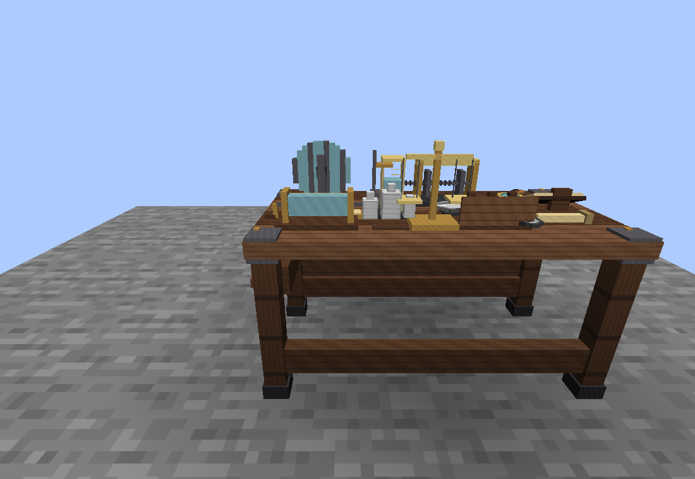
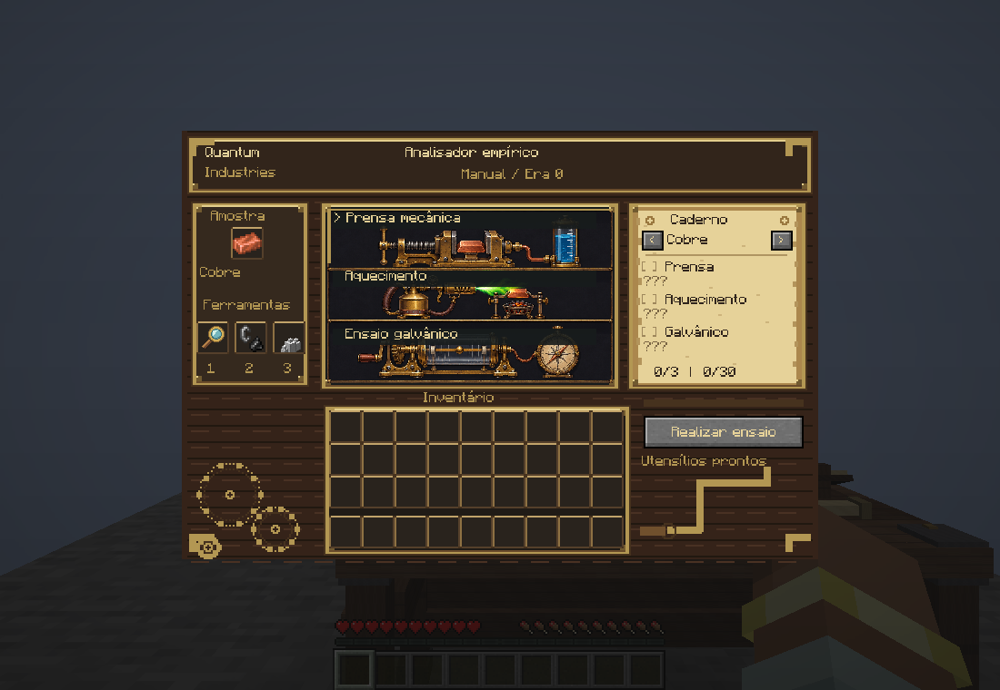

# Quantum Industries

**Um mod de Minecraft focado em ciência, engenharia e indústria avançada.**

Quantum Industries pretende levar o jogador de processos industriais básicos até química, ciência dos materiais, engenharia nuclear, computação quântica e tecnologias dimensionais. A progressão é guiada por investigação: observar, analisar, experimentar, documentar e transformar conhecimento em tecnologia.

> **Status:** protótipo jogável em desenvolvimento. A fundação NeoForge, a Mesa de Pesquisa e a primeira versão funcional da Bancada de Ensaio Empírico estão implementadas. A expansão industrial e a integração das novas observações com aplicações tecnológicas seguem planejadas.

## Visão do projeto

O objetivo não é apenas adicionar máquinas cada vez mais caras. O jogador deve descobrir como o mundo funciona e usar esse conhecimento para criar novas soluções industriais.

Pilares:
- **Pesquisa científica:** analisar materiais, formular hipóteses e realizar experimentos.
- **Progressão baseada em conhecimento:** descobertas e pesquisas liberam aplicações concretas.
- **Indústria em camadas:** processamento mecânico, energia, química, materiais, nuclear, quântica e dimensional.
- **Multiplayer com progresso individual:** cada jogador mantém seu próprio conhecimento, mesmo quando compartilha máquinas e instalações.
- **Minecraft como laboratório:** dimensões, criaturas, blocos e fenômenos do jogo inspiram sistemas próprios do mod.

## Progressão planejada

1. **Fundação:** infraestrutura do mod e sistema de pesquisa.
2. **Indústria inicial:** processamento de recursos, geração e armazenamento de energia.
3. **Química e materiais:** reações, separação, síntese e propriedades dos materiais.
4. **Engenharia atômica e nuclear:** análise de composição, isótopos, fissão e fusão.
5. **Computação avançada:** automação, redes de controle, computação quântica e IA.
6. **Tecnologia dimensional:** exploração e conversão de fenômenos energéticos de diferentes dimensões.

## Protótipo jogável atual

A **Bancada de Ensaio Empírico** permite investigar dez materiais: cobre, ferro,
ouro, carvão, diamante, quartzo, redstone, lápis-lazúli, esmeralda e ametista.
Cada material possui três observações, obtidas por prensa mecânica, aquecimento
e ensaio galvânico: são **30 descobertas individuais** no catálogo.

1. Coloque uma amostra aceita e a lupa na bancada.
2. Para a prensa, adicione os pesos de ferro; para aquecimento, o isqueiro vanilla.
3. Selecione um dos três métodos e clique em **Realizar ensaio**.
4. Aguarde 3 segundos e consulte a observação no caderno.
5. Complete os demais métodos para concluir o ciclo da amostra.

O primeiro ensaio reserva uma unidade da amostra. O ciclo pode ser retomado após
fechar a interface, trocar de bancada ou sair do mundo; a amostra é consumida ao
concluir os três métodos. As ferramentas são reutilizáveis. Fechar a HUD mantém
os itens na bancada, com salvamento no mundo; quebrá-la devolve os itens guardados.
As ferramentas e a amostra inseridas aparecem no modelo 3D. O caderno permite
consultar os materiais, mostra o progresso individual e revela somente as
observações já descobertas. Textos longos podem ser lidos ao passar o mouse.

A interface combina instrumentos mecânicos, madeira, latão e um caderno de
observações, com traduções em português e inglês. A bancada tem modelo próprio
e ocupa dois blocos. A lupa e os pesos têm itens, modelos e receitas próprios; o aquecimento usa o isqueiro vanilla.

A **Mesa de Pesquisa** mantém o sistema de pesquisas, relatórios científicos e
bloqueio da receita de cabo de cobre pelo servidor. As novas observações da
bancada ainda não liberam automaticamente tecnologias: sua integração com
pesquisas e receitas é a próxima etapa de design.

Consulte as regras completas e o catálogo em
[Bancada de ensaio](docs/design/bancada-de-ensaio/README.md).

## Imagens do protótipo





Mais imagens, receitas e regras estão no
[guia da Bancada de Ensaio](docs/design/bancada-de-ensaio/README.md).
Cada componente tem sua documentação no [índice de componentes](docs/design/README.md).

## Sistema de conhecimento

O projeto distingue três conceitos:

- **Descoberta:** conhecimento obtido por observação, análise ou experimento.
- **Pesquisa:** desenvolvimento de uma aplicação ou tecnologia que utiliza conhecimentos e recursos.
- **Desbloqueio:** autorização individual para fabricar ou utilizar uma tecnologia.

O conhecimento é individual e persistente por jogador. Receber um relatório científico de outro jogador pode transmitir conhecimento, mas não deve concluir automaticamente pesquisas práticas ou conceder qualquer tecnologia sem as condições definidas pelo jogo.

## Multiplayer

- Dados de pesquisa pertencem a cada jogador.
- O servidor é a autoridade para validar descobertas, pesquisas e desbloqueios.
- Máquinas podem ser compartilhadas, mas uma operação tecnológica deve respeitar a autorização do jogador que a inicia ou conclui.
- Relatórios científicos serão o mecanismo inicial de compartilhamento de conhecimento.

## Dimensões e energia

Overworld, Nether, End e futuras dimensões poderão apresentar recursos e fenômenos diferentes. A ideia é que máquinas de análise e coleta reconheçam o ambiente em que operam, em vez de tratar toda atmosfera, fluido ou fonte de energia como equivalente.

Tecnologias dimensionais — como extração de energia de End Crystals sem consumi-los — são conceitos de gameplay ficcional e deverão ser equilibradas como sistemas próprios do mod.

## Tecnologia e desenvolvimento

- **Minecraft:** 26.1.2.
- **Loader:** NeoForge 26.1.2.125.
- **Linguagem:** Java 25.
- **Build:** Gradle Wrapper 9.2.1.
- **Ambiente de desenvolvimento:** VS Code e Gradle.
- **Repositório:** [Vizinho-hn/Quantum-Industries](https://github.com/Vizinho-hn/Quantum-Industries).

As versões usadas pelo projeto estão fixadas em `gradle.properties`, `build.gradle` e no Gradle Wrapper.

## Documentação

- [Roadmap](ROADMAP.md)
- [Contribuição e fluxo Git](CONTRIBUTING.md)
- [Arquitetura inicial](docs/ARCHITECTURE.md)
- [Sistema de pesquisa](docs/RESEARCH_SYSTEM.md)
- [Bancada de ensaio: materiais, métodos e caderno](docs/design/bancada-de-ensaio/README.md)

## Estado atual e validação

- Projeto Gradle/NeoForge configurado, compilação concluída e JAR gerado.
- Bancada funcional com dez materiais, três métodos, reserva da amostra e caderno.
- Progresso individual persistente, retomada do ciclo e validação pelo servidor.
- Modelos da bancada e da Mesa de Pesquisa atualizados; ferramentas com assets próprios.
- Receita de sondas corrigida para o formato da versão atual do Minecraft.
- **11 testes automatizados passaram** na validação de 2026-11-04.
- **521 verificações de integração no servidor passaram**, incluindo inventário persistente, acesso compartilhado e queda de itens ao quebrar a bancada.
- Interface conferida no cliente: estado inicial, ensaio em andamento, descobertas
  e ciclo completo em 3/3 com consumo da amostra. O cliente de preview encerrou normalmente.

A causa dos dois travamentos do computador relatados durante o desenvolvimento
não foi determinada. A execução bem-sucedida do preview não comprova a resolução
desse problema.

Próxima etapa: definir as aplicações tecnológicas das observações e conectá-las
à progressão de pesquisas e receitas.

## Como rodar o projeto

```bash
# Clonar e entrar
git clone https://github.com/Vizinho-hn/Quantum-Industries.git
cd Quantum-Industries

# Compilar (baixa dependências na primeira vez)
./gradlew build

# Abrir o jogo no Linux
./Jogar.sh

# Cliente de desenvolvimento via Gradle
./gradlew runClient

# Rodar servidor de desenvolvimento
./gradlew runServer
```

**Requisitos:** JDK 25 e internet para baixar dependências Gradle/NeoForge na primeira execução.

## Como verificar

```bash
# Contratos e recursos
python3 -m unittest discover -s tests -v

# Integração em servidor dedicado e mundo isolado
./tools/verify-assay.sh

# Compilação normal
./gradlew build

# Preview automatizado da interface (Linux com Xvfb e cache Gradle preenchido)
./tools/preview-assay.sh
```

O preview usa um mundo separado em `build/assay-preview` e captura oito estados
da interface e dos itens exibidos na bancada. O limite de 30 FPS e as distâncias reduzidas pertencem a esse
procedimento de verificação. Para jogar manualmente, use `./gradlew runClient`.
As classes de verificação e preview ficam fora do JAR normal.

## Licença

A licença ainda não foi definida. Até que os autores decidam, não presuma que o código ou os assets estejam liberados para redistribuição.

## Abrir o jogo pelo atalho

- **Linux:** abra **Quantum Industries** no menu de aplicativos ou use o atalho
  na área de trabalho deste computador. No terminal, execute `./Jogar.sh`.
- **Windows:** dê dois cliques em `Jogar.bat` na raiz do repositório. O
  `Jogar.exe` existente também continua disponível.

É necessário ter JDK 25. O lançador usa o Gradle Wrapper e abre o cliente normal,
sem entrar no mundo de preview, automatizar cliques ou impor limite de FPS.
Na primeira execução, o Gradle pode baixar dependências. No Linux, o script usa
`/mnt/dados/cache/quantum-gradle` quando esse volume existe e evita abrir outra
instância do cliente do projeto. `./Jogar.sh --check` verifica os pré-requisitos
sem abrir o Minecraft. Feche e reabra o jogo para carregar alterações no código.
