# Quantum Industries

**Um mod de Minecraft focado em ciência, engenharia e indústria avançada.**

Quantum Industries pretende levar o jogador de processos industriais básicos até química, ciência dos materiais, engenharia nuclear, computação quântica e tecnologias dimensionais. A progressão é guiada por investigação: observar, analisar, experimentar, documentar e transformar conhecimento em tecnologia.

> **Status:** protótipo jogável em desenvolvimento. A Era I (Mecânica Clássica e Ciência Empírica, governada pelo **QKS**) tem 16 pesquisas, inclui a oficina mecânica, o Forno de Ligas a Fole, o Britador de Mandíbulas (beneficiamento 2×) e termina no Dínamo Manual. A Era II (**Industrialização Científica**, dividida entre **Ciências Térmicas / QTS** e **Eletricidade e Eletromagnetismo / QES**) conta com Indução Eletromagnética, Pilha Voltaica (2.400 FE), Acumulador de Chumbo-Ácido (50.000 FE), Prensa Eletromecânica, Fundidora de Ligas Elétrica (Alloy Smelter), **Fornalha Elétrica (`electric_furnace`)**, **Analisador de Rede Elétrica MK1** e Química Mineral Aplicada.

Os motores físicos compartilhados governam a simulação no servidor:
- **QKS** — Quantum Kinetic System ([arquitetura](docs/KINETIC_ENGINE_ARCHITECTURE.md)): núcleo cinético, solver de rede, sincronização de chunks, renderer nativo e telemetria nos óculos (`bash tools/verify-qks.sh`).
- **QES** — Quantum Electrical System ([arquitetura](docs/ELECTRICAL_ENGINE_ARCHITECTURE.md)): aproximação DC resistiva com circuito de retorno implícito, solver determinístico para fontes/cargas/gargalos, perdas Joule, integração FE e telemetria no [Analisador MK1](docs/ELECTRICAL_NETWORK_ANALYZER.md).
- **QTS** — Quantum Thermal System ([arquitetura](docs/THERMAL_ENGINE_ARCHITECTURE.md)): temperatura vs. energia térmica armazenada (`TU`), capacidade térmica, condução sem overshoot numérico, dissipação passiva/ativa e inércia térmica.
- **Visão Integrada** — [PHYSICS_SYSTEMS_ARCHITECTURE.md](docs/PHYSICS_SYSTEMS_ARCHITECTURE.md): contrato de conservação `PhysicsEnergyContract` (`1 FE = 1 TU` em aquecimento resistivo puro) e integração nos Óculos de Inspeção.

## Serraria Elétrica — Era II

Nova `electric_sawmill`: quatro entradas e quatro saídas reais (2×2), uma câmara com seleção circular, **1 tora → 8 tábuas em 40 ticks**, consumindo **160 FE** (4 FE/t). Buffer de 1.200 FE, recebimento limitado a 64 FE por tick. Integra cabos, tubos, óculos, JEI e Códice. A pesquisa **Processamento Eletromecânico de Madeira** exige Transmissão Mecânica, Indução Eletromagnética, Conformação Eletromecânica e os ensaios indicados no caderno. A Serraria Mecânica permanece disponível.

Implementação em revisão na branch `feat/electric-sawmill-era2`, sem merge automático. Veja [arquitetura, reprodução e evidências](docs/ELECTRIC_SAWMILL.md).

## Estabilização das Eras I e II

Veja [autorização de máquinas, orçamento de cabos e análise instrumental Tier 2](docs/ERA2_STABILIZATION.md), incluindo uso e testes pendentes.

## Visão do projeto

O códice, o caderno de pesquisas, os nomes e descrições dos itens e os relatórios acompanham o idioma do Minecraft: português em `pt_br` e inglês em `en_us`. As traduções ficam em `assets/quantumindustries/lang/`. A troca de idioma é verificada com `bash tools/verify-localization.sh`, em servidor isolado.

As cinco eras seguem a progressão: **Engenharia Mecânica e Ciência Empírica**,
**Revolução Elétrica**, **Ondas Eletromagnéticas e Tecnologia Moderna**,
**Engenharia Quântica** e **Inteligência Artificial e Automação Autônoma**.
O Dínamo Manual encerra o **arco de geração elétrica** da Era I, mas **não** é uma barreira geral para consultar ou avançar em todos os ramos da Era II. As eras agrupam pesquisas por tema; **o servidor só exige os pré-requisitos e evidências de cada estudo**. É possível desenvolver hidráulica, pneumática, recozimento ou trefilação em paralelo, se houver os conhecimentos específicos. O dínamo continua sendo necessário para pesquisar **Indução Eletromagnética**, que sustenta as máquinas elétricas.

### Pesquisas independentes e melhorias de rendimento

- **Ramos fundamentais:** habilitam uma técnica realmente necessária à máquina pretendida, não a passagem global de era.
- **Ramos opcionais de utilidade:** podem oferecer mais produção, menos desperdício, transporte de itens/fluidos ou conforto (ex.: roda-d'água, recozimento, trefilação e, futuramente, moagem de trigo e panificação).
- **Ramos de eletricidade:** preservam a cadeia própria de geração → indução → acumulação → proteção; continuam exigindo seus conhecimentos e evidências.
- **Pesquisa não concluída:** um estudo de outra era pode ficar visível e bloqueado por dependência específica, sem que a era inteira esteja inacessível.
- **Compatibilidade:** nada foi apagado do progresso dos jogadores e nenhuma receita bypassa o desbloqueio validado no servidor.


Nesta branch, a oficina mecânica traz serraria manual, transmissão por eixos
e roda-d'água, independente de FE. A integração na main depende da revisão do PR.
[Auditoria, funcionamento e validação](docs/ERA1_MECHANICAL.md).
Os eixos ajustam cada ponta à porta mecânica vizinha. Veja o [padrão de encaixe](docs/MECHANICAL_CONNECTION_STANDARD.md).

O objetivo não é apenas adicionar máquinas cada vez mais caras. O jogador deve descobrir como o mundo funciona e usar esse conhecimento para criar novas soluções industriais.

Pilares:
- **Pesquisa científica:** analisar materiais, formular hipóteses e realizar experimentos.
- **Progressão baseada em conhecimento:** descobertas e pesquisas liberam aplicações concretas.
- **Indústria em camadas:** processamento mecânico, energia, química, materiais, nuclear, quântica e dimensional.
- **Multiplayer com progresso individual:** cada jogador mantém seu próprio conhecimento, mesmo quando compartilha máquinas e instalações.
- **Minecraft como laboratório:** dimensões, criaturas, blocos e fenômenos do jogo inspiram sistemas próprios do mod.

## Progressão planejada

1. **Era I — Mecânica Clássica e Ciência Empírica (QKS):** materiais, metalurgia, mecanismos e aproveitamento hidráulico. O dínamo encerra a era.
2. **Era II — Industrialização Científica (QTS + QES):** dividida em Ramo A (Termometria e Termodinâmica) e Ramo B (Eletrostática e Eletrodinâmica), com geração, distribuição, armazenamento, motores, processos térmicos integrados e Fornalha Elétrica.
3. **Era III — Ondas Eletromagnéticas e Tecnologia Moderna (planejamento QWS/QPS):** eletrônica, sinais, pneumática avançada, sensores, comunicação e controle programável.
4. **Era IV — Engenharia Quântica (planejamento):** materiais avançados, precisão e processamento sofisticado.
5. **Era V — Inteligência Artificial e Automação Autônoma (planejamento):** planejamento e coordenação inteligente das instalações.

## 🖼️ Galeria Visual de Itens e Equipamentos

O Quantum Industries conta com um catálogo visual completo com ilustrações em pixel art de alta definição e modelos dos componentes e máquinas industriais.

> 👉 **[Consulte o Catálogo Completo com Todos os Itens e Máquinas Detalhados (docs/ITEMS.md)](docs/ITEMS.md)**

### Destaques das Eras I & II

| Instrumentos Científicos | Metalurgia & Conformação | Oficina & Transmissão | Geração & Eletricidade | Hidráulica & Fluidos |
| :---: | :---: | :---: | :---: | :---: |
| 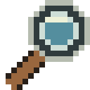<br><sub>**Lupa de Vidro**</sub> | 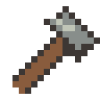<br><sub>**Martelo Manual**</sub> | 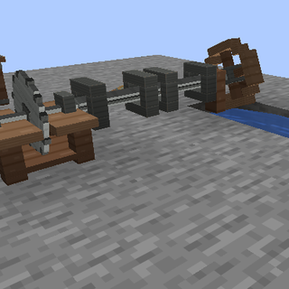<br><sub>**Serraria Mecânica**</sub> | 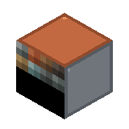<br><sub>**Dínamo Manual**</sub> | 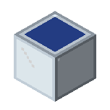<br><sub>**Cuba Decantação**</sub> |
| <br><sub>**Frasco de Ensaio**</sub> | 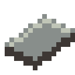<br><sub>**Chapa de Ferro**</sub> | 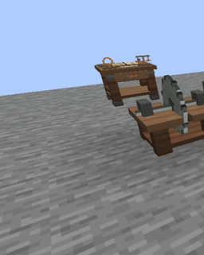<br><sub>**Roda-d'Água**</sub> | 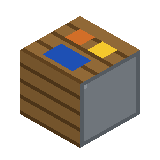<br><sub>**Acumulador (2.4k)**</sub> | 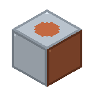<br><sub>**Bomba Peristáltica**</sub> |
| 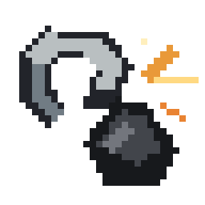<br><sub>**Kit de Chama**</sub> | <br><sub>**Bobina de Cobre**</sub> | 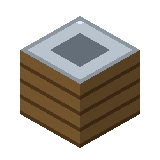<br><sub>**Bancada Conformação**</sub> | 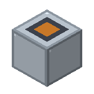<br><sub>**Prensa (FE)**</sub> | <br><sub>**Eletrólito**</sub> |
| 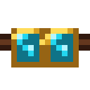<br><sub>**Óculos Inspeção**</sub> | <br><sub>**Núcleo Mecânico**</sub> | 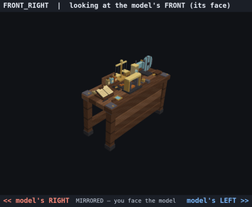<br><sub>**Analisador Materiais**</sub> | 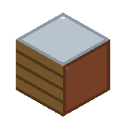<br><sub>**Trefiladora**</sub> | 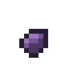<br><sub>**Sedimento**</sub> |

---

## Protótipo jogável atual

Com JEI instalado, os processos da serraria, britador, fornos de ligas, bancada de
conformação, prensa elétrica, trefiladora, braseiro, cuba de decantação e moedor
manual aparecem em categorias próprias, associadas às respectivas máquinas.
A consulta mostra insumos e produtos; pesquisas e operação continuam validadas
pelo servidor. Combustível, acionamento manual e energia continuam necessários
conforme as regras de cada equipamento.

Comece pela Mesa de Pesquisa Tier 1 e conclua **Observação dos Materiais**.
Essa é a entrada da Era I e libera o **Analisador de Materiais**, que reutiliza
o bloco da Bancada de Ensaio Empírico.

O analisador permite investigar **treze materiais** (cobre, ferro, ouro, carvão,
diamante, quartzo, redstone, lápis-lazúli, esmeralda, ametista, **estanho, zinco
e chumbo**) e quatro métodos, totalizando **52 descobertas individuais**.
Inspeção usa a lupa, aquecimento usa o fole manual e carvão, reação usa o frasco
de ensaio e o método mecânico usa a prensa. Cada ensaio dura 10 segundos. O
equipamento continua trabalhando quando a interface é fechada. As ferramentas e
os resultados pertencem ao sistema persistente da bancada e do jogador.

Os quatro métodos empíricos (inspeção, aquecimento, reação e prensa mecânica)
fornecem evidências científicas diretas e alternativas (`AnyOf`) para destravar
as pesquisas da Era I e a transição para a Era II. Descobertas persistem no
perfil individual e são reutilizadas sem consumo, enquanto cada pesquisa exige
seus materiais e conhecimentos anteriores.

[Regras científicas e compatibilidade](docs/SCIENTIFIC_RESEARCH.md).
[Materiais, métodos e instrumentos](docs/design/bancada-de-ensaio/README.md).

### Visual da Mesa de Pesquisa Tier 1

A Tier 1 tem bancada artesanal própria em madeira, ferro e cobre, com caderno
aberto, balança mecânica, lupa, bandeja de amostras e gaveta decorativa.
O modelo ocupa um único bloco, acompanha sua orientação e aparece também
no inventário. A Tier 2 mantém seu visual tecnológico.

[Modelo editável, textura e vistas](design/research_table_tier_1.md).

### Pesquisa e fabricação

- **Oficina mecânica:** Mecânica Fundamental e Transmissão Mecânica levam à
  Serraria Mecânica. Estude também Chapas Metálicas para fabricá-la. Uma tora
  rende seis tábuas da espécie correta em cinco segundos de movimento.
  Instale a manivela existente para começar sem eletricidade. Aproveitamento
  Hidráulico libera a roda-d'água, que transmite movimento por eixos alinhados.
  Crafts e processos aparecem na mesma aba Receitas Desbloqueadas.
  [Montagem, controles, limite de carga e testes](docs/ERA1_MECHANICAL.md).

- Os Analisadores Científicos Tier 1 e Tier 2 dão acesso à árvore de pesquisa,
  à Base de Conhecimento, às Receitas Desbloqueadas e aos Relatórios. Os
  ícones na árvore identificam os itens que cada pesquisa libera.
- As receitas aparecem no caderno e no livro da bancada de trabalho do
  Minecraft conforme o progresso individual. No livro do Minecraft, clicar
  na receita posiciona os ingredientes disponíveis. Desligue o filtro de
  fabricação para ver também as receitas para as quais faltam materiais.
- Produza as chapas na Bancada de Conformação com o martelo. Estrutura
  Eletromecânica libera a estrutura e o Núcleo Mecânico Primitivo, ambos em
  3D. Projeto do Dínamo libera o dínamo e habilita a linha elétrica baseada em Indução. Indução
  Eletromagnética é um estudo da Era II.
- Fabrique a manivela separadamente, instale-a e gire. O dínamo armazena até
  240 FE, gera 12 FE por giro, aceita um giro a cada 10 ticks e transfere energia
  para blocos elétricos adjacentes. Na Era II, o **Acumulador Galvânico** (bateria chumbo-ácido construída com **Chapas de Chumbo**, **Chapa de Cobre** e **Concentrado de Eletrólito Galvânico**) estoca
  até 2.400 FE e alimenta a **Prensa Eletromecânica**, que prensa lingotes em
  chapas consumindo 60 FE por ciclo sem gastar martelos. Os Óculos de Inspeção
  Energética exibem a carga e o estado ao mirar em qualquer bloco elétrico.

[Roteiro de sobrevivência e detalhes do dínamo](docs/MANUAL_DYNAMO.md)

### Fundição de Ligas (Era I & Era II)

- **Forno de Ligas a Fole (`bellows_alloy_kiln` — Era I):** liberado por Metalurgia de Ligas, fabricado com fogueira vanilla, tijolos, terracota, chapa, pedra lisa e fornalha. Produz bronze (3 cobre + 1 estanho → 4), latão (3 cobre + 1 zinco → 4), invar (2 ferro + 1 níquel → 3), electrum (1 ouro + 1 prata → 2), constantan (1 cobre + 1 níquel → 2) e aço (1 ferro + 2 carvão ou grafite → 1). Usa carvão/carvão vegetal e Fole Manual. Ligas complexas exigem calor relativo 160 (aço 240), o dobro do tempo elétrico e maior consumo durante a fusão. O britador pode ser fabricado somente com componentes mecânicos e vanilla.
- **Fundidora de Ligas Elétrica (`electric_alloy_smelter` — Era II):** liberada pela pesquisa **Fundição Eletrotérmica de Ligas**. Opera com energia elétrica (capacidade de 600 FE, consumo de 4 FE/t) e funde tanto as ligas da Era I quanto ligas refratárias e de precisão da Era II: **Invar** (`2 Ferro + 1 Níquel → 3 Invar`), **Electrum** (`1 Ouro + 1 Prata → 2 Electrum`), **Constantan** (`1 Cobre + 1 Níquel → 2 Constantan`) e **Aço** (`1 Ferro + 1 Pó de Grafite → 1 Aço`).
- **Chapas de Novos Metais e Ligas:** Chumbo, Estanho, Zinco e todas as seis ligas podem ser prensados em chapas na Bancada de Conformação Manual ou na Prensa Eletromecânica, com suporte a Common Tags (`#c:ingots/*`, `#c:nuggets/*`, `#c:plates/*`). Tanto o Forno a Fole quanto a Fundidora Elétrica aceitam **Lingotes** ou **Pós Minerais Purificados (`*_dust`)**.

### Beneficiamento Mineral 2× e Britador de Mandíbulas (`jaw_crusher`)

O britador usa o **A compacto (1×1×1)** em novas colocações. Posicione o hopper diretamente acima da cuba. A saída aceita extração pela frente da calha ou por um hopper abaixo dela. Clique com matéria prima para inserir e agache com a mão vazia para recolher. Britadores já instalados, incluindo o B de teste, mantêm a montagem e o inventário ao carregar o mundo.

- Liberado pela pesquisa **Beneficiamento e Cominuição Mineral** (`mineral_beneficiation` — Era I), o **Britador de Mandíbulas** processa cada receita com **três giros da manivela** ou com **torque do QKS**. No compacto A, ligue um eixo horizontal na face oposta ao volante. Quando há material e espaço na saída, o britador solicita **6 UM** e avança de acordo com o trabalho mecânico entregue.
- **Duplicação de Minérios (1 Bruto → 2 Pós):** tritura `raw_copper`, `raw_iron`, `raw_gold`, `raw_tin`, `raw_zinc`, `raw_lead`, `raw_nickel` e `raw_silver` em **2× Pós Purificados (`*_dust`)**. Cada pó pode ser fundido 1:1 em lingote na fornalha/alto-forno, usado diretamente nos fornos de liga ou analisado na Bancada de Ensaio Empírico.
- **Moagem Mecanizada e Carvão:** também mói **1 Trigo → 2 Farinhas** (dobrando o rendimento do Moedor Manual) e tritura **1 Carvão → 2 Pós de Grafite**.

### Química Mineral Aplicada (Fluorita, Halita, Grafite e Apatita)

- A pesquisa **Reagentes Ácidos e Química Mineral** (`chemical_leaching` — Era II) e o beneficiamento mineral dão função prática aos minerais não-metálicos do mod:
  - **Sal Gema / Halita (`salt_rock`) → Ácido Clorídrico Diluído (abstração de gameplay) (`hydrochloric_acid`):** processado na **Cuba de Decantação** com 1.000 mB de água e frasco de vidro, gerando um reagente engarrafado e sedimento mineral. Essa receita é uma abstração de gameplay; dissolver halita em água não produz HCl.
  - **Fluorita (`fluorite_gem`) como Fluxo Metalúrgico:** no Forno a Fole, uma unidade opcional reduz em 40 o limiar de calor relativo de um lote complexo, sem adicionar combustível nem calor. O Braseiro usa fontes térmicas externas e não consome fluorita.
  - **Grafite (`graphite_dust`) → Tijolo Refratário (`refractory_brick`):** usado na construção da Fundidora de Ligas Elétrica e como núcleo isolante da **Bobina Térmica de Constantan**.
  - **Apatita (`apatite_gem`) + Enxofre (`sulfur_dust`) → Fertilizante Fosfatado (`phosphate_fertilizer`):** fertilizante químico de alta eficiência que acelera o crescimento de plantações ao clicar com o botão direito.

### Moagem manual e panificação (Era I — implementação proposta neste PR)

A primeira cadeia de **Ciência Aplicada ao Cotidiano** é opcional: não constitui pré-requisito para a Era II nem altera a receita vanilla de pão.

- **Moedor Manual de Grãos**: receita ligada a `Observação dos Materiais` (usa madeira, pedra e ferro). Coloque trigo com clique direito; com a mão vazia clique para girar **quatro vezes** (intervalo mínimo de seis ticks). Segure a manivela do mod para girar da mesma forma; agache e clique sem item para retirar a farinha ou recuperar trigo ainda não moído. A máquina tem slots internos de entrada/saída persistentes e devolve os conteúdos ao ser quebrada.
- **Rendimento**: 1 trigo → 1 farinha; 2 farinhas + 1 balde de água → 1 massa (o balde deve retornar pelo comportamento vanilla de crafting); 1 massa assada na fornalha → 1 **Pão Rústico**.
- **Benefício**: 2 trigos por pão, em vez dos 3 da receita vanilla, mantendo **5 pontos de fome e saturação vanilla-equivalente**. O custo extra é a moagem, a água e o combustível do forno.
- **Sprites provisórios**: o moedor usa geometria voxel em madeira/pedra/ferro; os ícones de farinha, massa e pão referenciam texturas vanilla até os sprites finais em 32×32.
- **Pendente antes do merge**: validação de compilação, interação no cliente, balde retornado pela receita, drops, saves e multiplayer. Fermento e pão de alta saturação serão uma próxima expansão.

Os tubos de vidro de fluidos e os tubos pneumáticos usam paredes translúcidas azuladas e conexões ocas de cobre. O tubo pneumático se distingue pelo reforço central e mantém a visualização dos itens em trânsito.

### Distribuição elétrica inicial da Era II

Barramentos de Cobre Nu e Conduítes Isolados levam FE do dínamo e do acumulador até consumidores carregados por rede. O barramento admite até 32 FE/t e dissipa 1 FE por quatro segmentos nus no trajeto; o conduíte admite 64 FE/t, sem perda. A rede percorre somente chunks carregados, não cria FE e informa o fluxo nos Óculos de Inspeção. Os barramentos nus sob carga podem dar choque leve em entidades sem botas.

Ambos conectam-se a cabos e máquinas adjacentes nas seis direções, inclusive diretamente acima e abaixo. Modelo e hitbox acompanham cada conexão; vizinhos diagonais não se conectam. As conexões dos cabos salvos são recalculadas ao carregar. Verificação em servidor isolado: `bash tools/verify-cables.sh`.

O **Dínamo** aceita manivela ou movimento da roda-d'água pelo Eixo de Transmissão Mecânica. Retire a manivela com Shift + botão direito e conecte o eixo ao encaixe lateral. A geração automática consome **6 UM** da rede e produz **12 FE a cada 8 ticks** (1,5 FE/t). Um dínamo já colocado precisa de um clique de um jogador com Projeto do Dínamo para autorizar esse acionamento; novas colocações desse jogador já ficam autorizadas. A porta elétrica fica no lado oposto e alimenta cabos ou máquinas adjacentes. Eixo desconectado, água sem movimento ou sobrecarga interrompem a geração. O bloco mantém o ID `manual_dynamo` e a capacidade de 240 FE.

### Trefiladora de bancada

Após pesquisar **Trefilação de Fios** (com observações mecânicas de cobre e ouro), o jogador constrói a trefiladora. Uma chapa de **cobre, ouro, electrum ou constantan** rende 4 fios do respectivo metal (`copper_wire`, `gold_wire`, `electrum_wire`, `constantan_wire`). O equipamento funciona manualmente com a Manivela na mão ou alimentado por FE, consumindo 60 FE por operação automatizada. Fios de Constantan e Tijolos Refratários permitem fabricar a **Bobina Térmica de Constantan (`constantan_coil`)**, utilizada no aquecimento resistivo da Fundidora de Ligas Elétrica.

### Recozimento térmico

A Forja de Recozimento utiliza uma fonte térmica válida abaixo do bloco e recebe um lingote de **ferro, cobre, bronze, latão ou aço**, e utiliza o Fole Manual para sustentar o calor. Após 60 ticks quentes, o material fica trabalhável por até 600 ticks do mundo (`heated_*_ingot`). Se ainda quente, a Bancada de Conformação produz chapa com um golpe e a Prensa completa o ciclo em 10 ticks (30 FE), mantendo o rendimento de 1 chapa/lingote. O calor não cria itens nem energia elétrica.

### Instrumentação da Era II

- **Analisador de Rede Elétrica MK1 (`electrical_network_analyzer`):** coloque em uma face de um cabo e abra o painel com clique direito após Controle de Carga. Instrumento passivo, sem buffer, limitado a 16 blocos e 128 nós conectados carregados. Mostra injeção/entrega FE/t, perdas, reserva real dos equipamentos, histórico de 60 segundos de simulação, mapa XZ e seis maiores picos de utilização dos cabos. Escopos incompletos são sinalizados; os fluxos medidos são transferências da rede de cabos, não produção/consumo interno de cada máquina. Veja [telemetria elétrica](docs/ELECTRICAL_NETWORK_ANALYZER.md).

O **Transdutor Piezoelétrico** transforma impactos discretos em pulsos de 40 FE, com intervalo mínimo por entidade e proteção contra geração AFK imóvel. Ele mantém um buffer interno de 200 FE e pode carregar máquinas adjacentes ou pelos cabos. O contato inicial e o deslocamento real dos pés sobre a placa são detectados no servidor, inclusive quando a velocidade informada pelo jogador é zero. Uma entidade parada não gera pulsos repetidos; a saída total por placa é limitada a 40 FE/t.

O **Relé de Carga** acompanha um acumulador galvânico diretamente adjacente. Abaixo de 10% ele interrompe o fornecimento a máquinas; acima de 80% emite sinal de redstone de intensidade 15. O relé armazena até 96 FE para encaminhamento, sem geração própria.

### Pneumática, hidráulica e decantação (protótipo Era II)

A pesquisa **Pressão Pneumática** libera os tubos de vidro/cobre, o ejetor e o classificador gravitacional. Coloque o ejetor apontado do baú/fornalha/prensa para um tubo; sopre com **Fole Manual** ou use **Manivela** (1 item, Shift = até 1 pilha) ou forneça **10 FE por pulso** (modo automático com 1 item). Os tubos guardam pacotes individuais por segmento e exibem os itens viajando dentro do vidro. Os tubos descarregam em baús, fornalhas ou na entrada da prensa. Um classificador pode encaminhar itens em linha reta ou para a direita, com peneira alternável por clique com barras de ferro; as categorias são discretas (pós vs lingotes), não densidade contínua. Os modelos 3D são protótipos voxel com texturas vanilla e podem ser refinados no Blockbench.

A pesquisa **Hidrostática e Vasos Comunicantes** libera os dutos de cobre e vidro e a **Cuba de Decantação**. A rede transporta fluidos pela API NeoForge 26.1 `ResourceHandler<FluidResource>` sem usar `IFluidHandler` legado. Os dutos (250 mB de volume interno) escoam lateralmente/para baixo; a **Bomba Peristáltica** liberada por pesquisa própria transfere até **50 mB/t** usando **2 FE por tick** ou uma manivela manual, e pressuriza trechos subsequentes para vencer desníveis. A entrada traseira tem prioridade; se não transferir fluido, a bomba tenta captar pela face inferior (fonte renovável 2×2, duto ou reservatório). A saída continua frontal; não soma vazões nem consome FE se não houver transferência. O modelo da bomba usa câmara industrial, tubulação de cobre, cintas de latão e textura própria da Era II.

A cuba tem 8.000 mB de capacidade. Com **1.000 mB de água + 1 pó de enxofre (ou lápis-lazúli) + 1 frasco de vidro**, após decantação controlada produz **1 Concentrado de Eletrólito Galvânico** (item engarrafado, usado na fabricação do Acumulador Galvânico chumbo-ácido) e **1 Sedimento de Pigmento**. Com **Sal Gema (`salt_rock`)**, produz **1 Ácido Clorídrico Diluído (`hydrochloric_acid`)** e **1 Sedimento de Pigmento**, por uma abstração de gameplay, não uma reação química real.

## Serraria automática e reserva elétrica nos óculos

A Serraria Mecânica recebe toras e entrega tábuas pelos tubos de itens. Um tubo
com a ponta voltada à máquina em **Empurrar** alimenta a entrada; outro em
**Puxar** recolhe somente os produtos. Máquinas novas vinculam a automação ao
jogador pesquisado que as coloca. Nas antigas sem vínculo, interaja com a
serraria após concluir Transmissão Mecânica. O vínculo persiste entre lotes e
reinícios, e as permissões continuam individuais.

Os óculos mostram entrada, corte, saída, toras armazenadas, tábuas prontas e
progresso em painel industrial. **Shift** mantém o diagnóstico QKS abaixo.
Nos cabos, o painel distingue **fluxo/limite de transmissão**, perdas e a
**reserva dos equipamentos conectados** no trecho inspecionado. Cabos não
armazenam FE; fluxo não é exibido como carga de bateria.
[Funcionamento e testes](docs/SAWMILL_LOGISTICS.md).

## Visualização hidráulica dos óculos

Mire a roda-d'água com os Óculos de Inspeção e segure **Shift**: setas azuis
mostram o fluxo real; setas duplas verdes/vermelhas indicam torque favorável ou
contrário à rotação. Em repouso, âmbar identifica a referência positiva do eixo.
O HUD mostra parcelas positivas, negativas e soma hidráulica local, RPM e
aceleração em unidades QKS, preservando a inspeção de rede. Funciona nas rodas
1×1, 3×3 e 5×5. O capítulo opcional **Como a Água Movimenta as Rodas** usa a
pesquisa hidráulica existente. [Arquitetura, limites e QA](docs/HYDRAULIC_INSPECTION.md).

## Interfaces de processamento

Abra a **Fundidora de Ligas Elétrica** com botão direito para acessar as duas
entradas, saída e inventário. A tela tem câmara de fusão, carga em FE, progresso
e o nome da liga produzida, como **Fundindo Bronze**. O consumo mostrado segue
a receita real. Entradas, saída e progresso pertencem à máquina e ficam
guardados ao fechar a interface.

O **Britador de Mandíbulas** usa a mesma organização, com uma entrada, saída,
mandíbulas ilustradas, progresso e nome do material em britagem. O botão
**Acionar manivela** usa a manivela presente no inventário, respeitando a
pesquisa e o intervalo entre giros. O acionamento com a ferramenta na mão
também continua disponível. Shift + clique transfere itens entre os slots e
o inventário, e o servidor valida os ingredientes e as pesquisas.

## Chave de Configuração e pontas dos tubos

A **Chave de Configuração** é liberada por Mecânica Fundamental e aparece no
caderno e na aba criativa. Sua receita usa dois lingotes de ferro nos cantos
superiores, uma engrenagem de ferro no centro e um graveto abaixo dela.

Clique na ponta de um tubo de itens, duto de cobre/vidro ou cabo elétrico para
alternar **Entrada e saída → Puxar → Empurrar → Nenhum**. Os modos são relativos ao segmento
selecionado: Puxar é entrada e Empurrar é saída. Cada uma das seis direções
tem configuração própria. **Shift + clique** seleciona **Entrada e saída**, o padrão
dos tubos novos e dos saves anteriores. Nenhum bloqueia a passagem nessa ponta.
Nos cabos elétricos, Entrada e saída permite que uma bateria receba energia e
depois alimente consumidores usando a mesma conexão.

Tubos de itens em Puxar retiram um item por vez de inventários e saídas de
máquinas adjacentes; as pontas de saída encaminham o pacote até o destino.
Ao alimentar uma Fundidora Elétrica, o tubo percorre os slots do inventário de
origem e pula materiais que a máquina não aceita no momento (por exemplo, cobre
cheio antes do estanho). Cada metal ocupa apenas uma entrada da fundidora,
tanto pela interface quanto por automação. Pacotes excedentes já em trânsito
podem voltar ao inventário de origem pela conexão de extração, sem descarte;
se não houver espaço, permanecem no tubo. A busca respeita as conexões e limita-se
a 256 estados por tentativa, sem carregar chunks.
Dutos em Puxar recebem fluidos dos reservatórios adjacentes e Empurrar dirige
a saída. Trechos ascendentes continuam usando pressão da bomba. Nos cabos,
Puxar recebe FE da fonte e Empurrar libera FE para o destino, com os limites
e perdas do tipo de cabo. Configurações e conteúdo ficam salvos ao reiniciar.

Equipe os **Óculos de Inspeção Energética** e mire na ponta desejada. O painel
mostra a direção e o modo da mesma ponta que a chave seleciona, além da leitura
de energia ou fluido do segmento. Os quatro estados são traduzidos em PT-BR
e EN-US. Testes dedicados: `bash tools/verify-connections.sh`, em dois
carregamentos de um mundo isolado, incluindo conservação, bloqueios e retomada.

## Imagens do protótipo

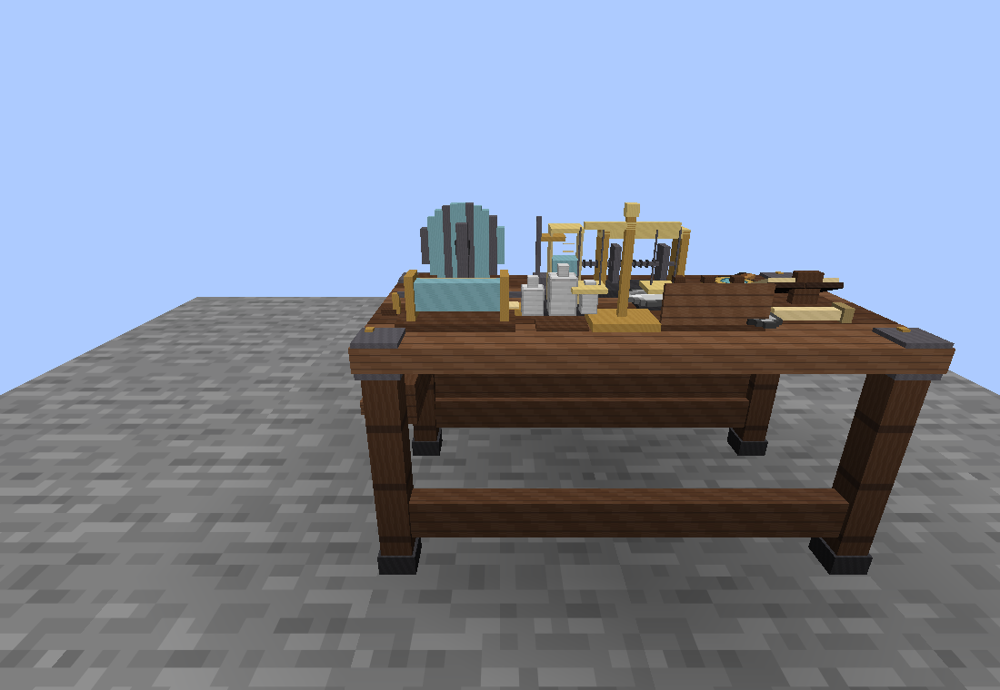

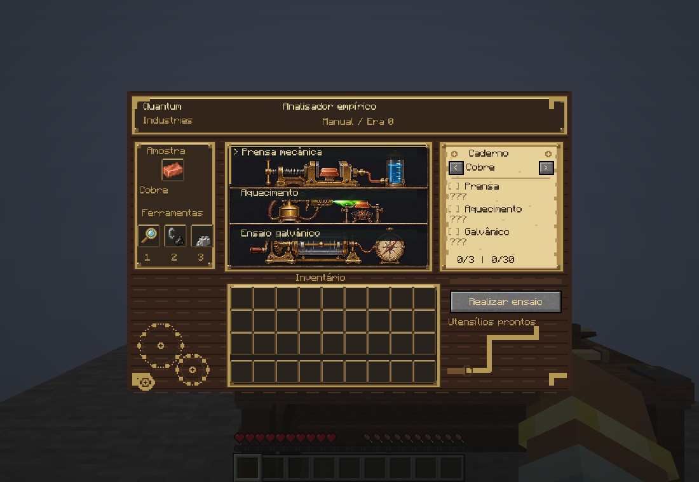

Mais imagens, receitas e regras estão no
[guia da Bancada de Ensaio](docs/design/bancada-de-ensaio/README.md).
Cada componente tem sua documentação no [índice de componentes](docs/design/README.md).

## Sistema de conhecimento

O projeto distingue três conceitos:

- **Descoberta:** conhecimento obtido por observação, análise ou experimento.
- **Pesquisa:** desenvolvimento de uma aplicação ou tecnologia que utiliza conhecimentos e recursos.
- **Desbloqueio:** autorização individual para fabricar ou utilizar uma tecnologia.

O conhecimento é individual e persistente. Na aba **Relatório de pesquisa**,
guarde tinta preta, pena e papel no analisador. Selecione uma pesquisa concluída
e clique em **Escrever relatório** para gastar uma unidade de cada material.
Os insumos guardados permanecem no bloco. Outro jogador pode usar o relatório
com o botão direito para aprender a pesquisa se já tiver os conhecimentos
anteriores e as evidências científicas exigidas.

Para compartilhar as quatro observações de um material, conclua os ensaios 4/4, segure uma pena na mão principal e uma amostra do material na mão secundária, leve um papel no inventário e clique com o botão direito no Analisador Científico. Isso gera uma Ficha de Observação, que outro jogador pode consumir para adquirir somente aquelas quatro descobertas, sem desbloquear pesquisas automaticamente.\n\nEm multiplayer, o servidor valida pesquisas, operações e receitas para cada
jogador, inclusive quando a bancada é compartilhada.

### Comandos administrativos

Com permissão de operador, o jogador pode usar
`/quantum:desbloquear_pesquisas` para liberar as pesquisas e
`/quantum:clear_conhecimento` para limpar o próprio progresso de pesquisa.
O livro de receitas acompanha o novo estado. O desbloqueio administrativo
concede as pesquisas diretamente. A limpeza de pesquisas mantém as descobertas
experimentais registradas no perfil do jogador.

## Dimensões e energia

Overworld, Nether, End e futuras dimensões poderão apresentar recursos e fenômenos diferentes. A ideia é que máquinas de análise e coleta reconheçam o ambiente em que operam, em vez de tratar toda atmosfera, fluido ou fonte de energia como equivalente.

Tecnologias dimensionais — como extração de energia de End Crystals sem consumi-los — são conceitos de gameplay ficcional e deverão ser equilibradas como sistemas próprios do mod.

## Tecnologia e desenvolvimento

- **Minecraft:** 26.1.2.
- **Loader:** NeoForge 26.1.2.125.
- **Linguagem:** Java 25.
- **Build:** Gradle Wrapper 9.2.1.
- **Ambiente de desenvolvimento:** VS Code e Gradle.
- **Repositório:** [Vizinho-hn/Quantum-Industries](https://github.com/Vizinho-hn/Quantum-Industries).

As versões usadas pelo projeto estão fixadas em `gradle.properties`, `build.gradle` e no Gradle Wrapper.

## Documentação

- [Roadmap](ROADMAP.md)
- [Contribuição e fluxo Git](CONTRIBUTING.md)
- [Arquitetura inicial](docs/ARCHITECTURE.md)
- [Sistema de pesquisa](docs/RESEARCH_SYSTEM.md)
- [Bancada de ensaio: materiais, métodos e caderno](docs/design/bancada-de-ensaio/README.md)

## Como rodar o projeto

```bash
# Clonar e entrar
git clone https://github.com/Vizinho-hn/Quantum-Industries.git
cd Quantum-Industries

# Compilar (baixa dependências na primeira vez)
./gradlew build

# Abrir o jogo no Linux
./Jogar.sh

# Cliente de desenvolvimento via Gradle
./gradlew runClient

# Rodar servidor de desenvolvimento
./gradlew runServer
```

**Requisitos:** JDK 25 e internet para baixar dependências Gradle/NeoForge na primeira execução.

## Quantum Kinetic System

O QKS reúne núcleo de dinâmica angular, solver por componente, sincronização de chunks,
transmissões por engrenagens 8:16/16:8, volante de ferro, polias/correias e rodas-d'água
1×1/3×3/5×5. O renderer nativo preserva a geometria existente. Os Óculos de Inspeção
recebem RPM, aceleração, torques, inércia, potência, razão e motivo de parada do servidor;
os capítulos de física do Códice são opcionais e não bloqueiam pesquisas.

A suíte `bash tools/verify-qks.sh` usa duas inicializações de servidor dedicado para
verificar física, produção, transmissões, persistência e isolamento de classes cliente.
A aceitação dedicada do PR 3 passou nas fases write/read, incluindo persistência após
reinício completo (`read assertions=30`) e isolamento de classes nas duas JVMs.
O preview cliente verificou o HUD normal, os diagnósticos com Shift e a paginação do
Códice com telemetria recebida do servidor. Consulte [evidências e limites da verificação](docs/KINETIC_ENGINE_ARCHITECTURE.md).

## Como verificar

O CI executa a migração de pesquisas com `./gradlew verifyLegacyResearch`, usando
as dependências do Minecraft/NeoForge configuradas no projeto.

```bash
# Contratos e recursos
python3 -m unittest discover -s tests -v

# Integração da Bancada de Ensaio em um mundo isolado
./tools/verify-assay.sh

# Integração da Era I, receitas, relatórios, comandos e dínamo
./gradlew --init-script tests/dynamo.init.gradle runServer

# Compilação normal
./gradlew build

# Preview automatizado da interface (Linux com Xvfb e cache Gradle preenchido)
./tools/preview-assay.sh
```

O preview usa um mundo separado em `build/assay-preview` e captura oito estados
da interface e dos itens exibidos na bancada. O limite de 30 FPS e as distâncias reduzidas pertencem a esse
procedimento de verificação. Para jogar manualmente, use `./gradlew runClient`.
As classes de verificação e preview ficam fora do JAR normal. Para preparar o
servidor de teste do dínamo, consulte [Dínamo Manual V1](docs/MANUAL_DYNAMO.md).

## Licença

**Todos os direitos reservados (© 2026 Hian e Guilherme).** A concepção e a idealização do Quantum Industries são atribuídas a Hian e Guilherme. O acesso público ao repositório não concede licença para copiar, modificar, redistribuir ou explorar os conteúdos originais do projeto. Consulte o arquivo [LICENSE](LICENSE) para os termos completos, respeitados os direitos e licenças de terceiros.

## Abrir o jogo pelo atalho

- **Linux:** abra **Quantum Industries** no menu de aplicativos ou use o atalho
  na área de trabalho deste computador. No terminal, execute `./Jogar.sh`.
- **Windows:** dê dois cliques em `Jogar.bat` na raiz do repositório. O
  `Jogar.exe` existente também continua disponível.

É necessário ter JDK 25. O lançador usa o Gradle Wrapper e abre o cliente normal,
sem entrar no mundo de preview, automatizar cliques ou impor limite de FPS.
Na primeira execução, o Gradle pode baixar dependências. No Linux, o script usa
`/mnt/dados/cache/quantum-gradle` quando esse volume existe e evita abrir outra
instância do cliente do projeto. `./Jogar.sh --check` verifica os pré-requisitos
sem abrir o Minecraft. Feche e reabra o jogo para carregar alterações no código.


### Interruptor Elétrico Industrial (Era II)

O `industrial_circuit_switch` utiliza a rede de cabos existente, sem buffer de FE, com dois terminais horizontais e limite de 64 FE por tick. Clique com a mão vazia para abrir/fechar; Shift + clique alterna entre controle manual e redstone (sinal fecha o circuito). A chave gira o eixo horizontal. Rotas alternativas de cabos continuam independentes. Pilha Voltaica (2.400 FE) e Acumulador Chumbo-Ácido (50.000 FE) possuem orçamentos agregados de carga e descarga de 48 e 256 FE/t, respectivamente, compartilhados entre conexões diretas e cabos. Integração em validação; ainda não é uma entrega final da Era II.


### Caixa de Transmissão Compacta (Era I)

`compact_gearbox` conecta dois eixos perpendiculares (quatro faces) em relação de módulo 1:1. O eixo indicado na colocação/chave é o eixo excluído; os outros dois são ligados por engrenagens cônicas internas. O QKS mantém um único rotor, com inversão de sinal entre eixos, inércia própria e eficiência de porta de 98% (aproximadamente 96% em uma passagem entre duas portas). Não fornece UM nem FE. Requer Transmissão Mecânica e Chapas Metálicas. A carcaça aberta ocupa o bloco inteiro e deixa os dois conjuntos de bronze e aço visíveis, com encaixes embutidos nas faces. As engrenagens e eixos usam a fase sincronizada do QKS e os óculos mostram RPM por eixo e perda nominal.

### Esteira Mecânica (Era I)

`mechanical_conveyor` transporta uma unidade de item por segmento, movida pelo QKS. Ligue um eixo perpendicular à direção da esteira e alinhe segmentos horizontalmente. A rotação define velocidade e sentido; uma saída obstruída retém a carga. A interação vincula um operador com Transmissão Mecânica; clique com o item para inserir e agache com a mão vazia para retirar. Baús, barris, funis e máquinas compatíveis podem servir de entrada/saída, respeitando pesquisas. A carga e sua posição são persistidas; o renderizador mostra o item em trânsito. A geometria da correia é estática nesta implementação inicial. Validação em jogo pendente.

### Conversão energética industrial (Era II)

- **Gerador Eletromagnético:** usa 12 UM de carga do QKS e produz até 8 FE/t em função da velocidade; buffer de 1.200 FE. Eixo à direita e terminal elétrico à esquerda da face frontal.
- **Motor Elétrico:** recebe FE pelo terminal esquerdo e produz até 18 UM no eixo direito, pagando 24 FE/t antecipadamente. Shift + clique com mão vazia desativa ou reativa.
- **Caldeira a Vapor:** água (4.000 mB) por balde ou tubulação e carvão/carvão vegetal; converte 10 mB/t em 10 unidades de vapor, com buffer de 2.000 unidades e 160 ticks úteis por combustível. A saída frontal entrega vapor a um Transportador de Gases de Cobre ou diretamente a um motor adjacente.
- **Motor a Vapor:** entrada traseira conectada a um transportador de gases ou à saída da caldeira; consome 10 unidades de vapor/t antes de fornecer até 24 UM no eixo direito.
- **Gerador Termoelétrico:** fontes quente e fria em faces opostas nos três eixos; até 6 FE/t conforme gradiente, reserva de 480 FE e saída frontal. Lava direta excede o limite térmico de 250 °C; magma e fogo são alternativas. Refrigerantes finitos aquecem e podem ser consumidos; apenas o melhor par é utilizado. Taxas são valores de balanceamento, não medidas termodinâmicas reais. Clique direito abre o painel térmico; Shift + clique mantém a inspeção. Quatro slots aceitam dissipadores de cobre/alumínio e ventiladores (1 FE/t ativo), renderizados no chassi. A temperatura ambiente depende do bioma; a troca térmica tem sinal e pode aquecer o refrigerante em ambientes quentes. Água parada também pode congelar. O painel registra 60 amostras de temperatura, eficiência bruta e produção líquida, em segundos de simulação; o histórico reinicia ao descarregar a entidade. A conversão entre unidade térmica e FE é uma convenção de gameplay.

Os equipamentos usam pesquisas existentes, vínculo persistente de operador, a rede elétrica e o QKS. Não introduzem um sistema de energia paralelo. Os modelos são editáveis no Blockbench; revisão visual, testes de servidor e balanceamento permanecem necessários.

### Códice — máquinas das Eras I e II

O Códice inclui capítulos próprios para Caixa de Transmissão Compacta, Esteira Mecânica, Interruptor Elétrico Industrial, Gerador Eletromagnético, Motor Elétrico, Caldeira, Motor a Vapor, Gerador Termoelétrico, Guincho de Contrapeso Gravitacional e Tambor de Mola Helicoidal. Os capítulos exigem as pesquisas aplicáveis, inclusive Chapas Metálicas ou Recozimento Térmico quando necessário. Textos PT-BR/EN-US descrevem a operação, os limites e as portas; receitas continuam na mesa de pesquisa/JEI. Não altera pesquisas já concluídas nem dados de saves.

### Dínamo e alternador industrial

O dínamo usa ímã permanente: 12 FE por acionamento manual válido, ou produção por eixo de até 1,5 FE/t a 12 RPM. O antigo `electromagnetic_generator` é agora o Alternador Eletromagnético, sem alteração de ID: requer 24 FE de excitação no terminal elétrico, usa 1 FE/t de geração bruta para autoexcitação e fornece até 8 FE/t líquidos entre 50–60 RPM. Carga QKS de 2–12 UM conforme produção; proteção térmica em sobrevelocidade. Rede FE preservada (retificação interna). Novas pesquisas: Excitação Eletromagnética, Corrente Alternada e Retificação, Geração Eletromagnética Industrial e Armazenamento de Energia Mecânica. Os sete componentes magnéticos e o alternador possuem receitas e capítulos no Códice. Guincho e tambor de mola passam a ter receitas protegidas por pesquisa. Validação de servidor/cliente pendente.

Correção local de integração: restaurados os registros de máquinas de conversão industrial, esteira, caixa de engrenagens e chave de circuito que estavam ausentes, impedindo a compilação da main.

### Abastecimento automático da caldeira

Carvão ou carvão vegetal: baú → Transportador de Itens em Puxar → tubo em Empurrar na caldeira, ou esteira. O combustível incompatível ou excedente não é consumido. Água: Transportador de Líquidos vindo de tanque ou de fonte renovável (bloco-fonte com duas fontes adjacentes horizontais), com Puxar na captação e Empurrar na caldeira. Use bomba peristáltica para elevar água. As entradas ficam nas faces não frontais; a frente entrega vapor ao duto vedado ou diretamente ao motor. A água não pode ser extraída pelo porto de entrada. A pesquisa e o vínculo do operador continuam necessários para consumir combustível/produzir vapor.

### Transportadores industriais

Itens, líquidos, gases e energia usam redes independentes. Na Era II, a pesquisa **Transporte de Gases Industriais** libera a receita de quatro Transportadores de Gases de Cobre. Ligue a saída frontal da caldeira à entrada traseira dos motores. Uma única caldeira produz 10 uV/t e cada motor ativo consome 10 uV/t. Ramificações dão acesso a mais motores, mas a produção limita o trabalho total sustentado.

Use os Óculos de Inspeção para conferir o conteúdo, a pressão, a temperatura e a vazão do duto e a Chave de Configuração para alterar a direção permitida por face. O [guia de transporte industrial](docs/INDUSTRIAL_TRANSPORT.md) detalha as portas, os limites e a migração.
