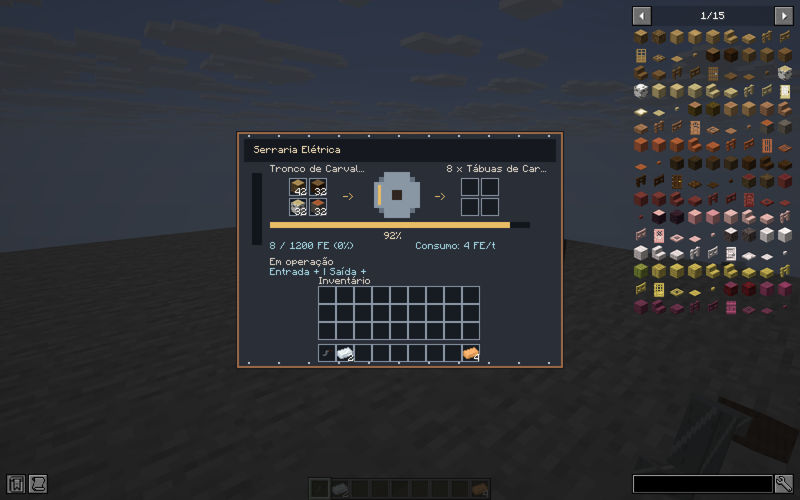

# Serraria Elétrica — Era II

Implementação na branch `feat/electric-sawmill-era2`, destinada a PR sem merge automático. ID: `quantumindustries:electric_sawmill`.

## Operação e balanceamento

| Regra | Valor |
|---|---|
| Entrada / saída | 4 slots + 4 slots, ambas grades 2×2 |
| Câmara | Uma tora por ciclo, seleção circular determinística |
| Resultado | 8 tábuas da espécie correspondente |
| Duração | 40 ticks pagos (2 segundos a 20 TPS) |
| Consumo | 4 FE/t, 160 FE por ciclo |
| Reserva / recebimento | 1.200 FE / até 64 FE somados por tick |
| Bloqueios | Falta de energia, saída sem espaço, material incompatível ou pesquisa ausente |

A pausa mantém o progresso. Retirar a amostra ativa ou substituir seu material reinicia o corte; FE já gasto não é reembolsado. Entradas diferentes alternam por slot, sem processar quatro toras ao mesmo tempo. O ciclo só paga FE quando todo o resultado cabe nas saídas. Slots compatíveis são preenchidos antes dos vazios. As variantes de toras, madeiras descascadas e madeiras do Nether são as existentes em `MechanicalProcesses`; bambu não foi incluído como tora.

## Pesquisa e craft

**Processamento Eletromecânico de Madeira** (`electric_wood_processing`) depende de Transmissão Mecânica, Indução Eletromagnética e Conformação Eletromecânica. Reutiliza os ensaios de prensa mecânica do ferro e reação do cobre, com custo de pesquisa de 2 lingotes de ferro e 2 de cobre. Não cria novos ensaios. O estudo foi acrescentado ao final do catálogo para manter os índices anteriores.

Craft protegido pelo servidor:

| | | |
|---|---|---|
| Chapa de ferro | Bobina de cobre | Chapa de ferro |
| Engrenagem de bronze | Serraria Mecânica | Núcleo mecânico primitivo |
| Fio isolado | Estrutura eletromecânica | Fio isolado |

A Serraria Mecânica permanece com seu ID, rendimento e acionamento existentes. O Códice documenta operação; o JEI exibe espécies, resultado, duração e FE por corte.

## Arquitetura e persistência

- `ElectricSawmillBlockEntity`: estoque real, reserva da amostra, custo transacional, seleção circular, vínculo com operador autorizado e armazenamento NBT.
- `ElectricSawmillMenu`: compartilha esse estoque com os menus abertos; slots 0–3 recebem madeira e 4–7 só permitem retirar. Inclui 27 slots e hotbar reais, drag e Shift normais do Minecraft.
- `ElectricSawmillScreen`: metal escuro/cobre, FE azul, progresso âmbar, material/produto e conexão verificável dos tubos. Nomes longos usam reticências; o tooltip do item permanece nativo.
- `ItemRouting`: consulta capacidade sem mutação, insere somente materiais válidos e extrai somente saídas. Mantém modos, limites de busca, pesquisa e chunks carregados existentes.
- `CableNetwork` / `EnergyInspectable`: usa a rede existente, com `SimpleEnergyHandler` e teto agregado de recebimento por tick. Não adiciona buffer aos cabos.
- NBT conserva estoque, energia, progresso, índice ativo/próximo, receita, amostra reservada e operador. A restauração suspende os callbacks que normalmente invalidam a reserva ao trocar a entrada.
- Os óculos reutilizam a inspeção existente. O renderizador nativo compartilha o compilador de meshes do QKS; a nova máquina não participa da física cinética. Lâmina e carro só avançam durante trabalho autorizado; a interpolação cliente é limitada ao intervalo de sincronização.

## Arte

Atlas original de 128×128, modelo estático de bloco/item e fonte editável [`electric_sawmill.bbmodel`](../design/models/electric_sawmill.bbmodel), com grupos `base`, `rotor` e `carriage`. A madeira do grupo `carriage` é uma prévia que o renderer esconde quando não há corte. Todos os elementos ficam dentro de 16³; a seleção e colisão usam um bloco inteiro. A orientação acompanha a face horizontal de colocação.

A direção aplicada segue `ART_DIRECTION.md` e `ERA2_VISUAL_STYLE_GUIDE.md`: estrutura metálica, motor/bobina, guia e proteção parcial. Nenhuma nova imagem de referência acompanhou o texto desta tarefa; não se afirma reprodução exata de uma imagem ausente. O `.bbmodel` foi produzido como fonte editável; não foi executado o `check_model` do aplicativo Blockbench nesta sessão.

## Validação executada

- 58 testes Python de contrato: aprovados.
- Servidor dedicado, três JVMs: **79 verificações de processamento/craft/menus/FE**, **6 de reinício e drops**, **5 de recarga real de chunk**. Inclui duas instâncias de menu com FakePlayers, retirada parcial com Shift, pausa/retomada, espécies e variantes, craft real e consumo dos ingredientes. Auditoria de classes sem classes de cliente no servidor dedicado.
- Cliente real isolado: instalação **roda-d’água → QKS → dínamo → cabo → serraria** e **baú → tubo → serraria → tubo → baú**, com asserção dos estoques no servidor, sem injetar FE na instalação.
- Dez capturas nativas: 1600×1000 em escalas 2/3 e 1280×720 em escala 2. Incluem menus reais, quatro espécies, bloqueios, óculos, árvore, JEI e Códice. Pesquisa/Códice no preview recebem estados de QA no cliente para exibir as páginas; permissões/craft são verificados separadamente no servidor dedicado.
- Regressão QKS: 786 verificações na escrita e 30 após reinício, aprovadas.
- Regressão da Serraria Mecânica: 201 verificações na escrita e 156 após reinício/recarga de chunk, aprovadas.
- `verifyLegacyResearch` e build normal aprovados; JAR de produção sem classes de QA.

Dois clientes humanos conectados simultaneamente não foram utilizados; a concorrência de inventário foi exercitada por dois menus no mesmo servidor. A avaliação artística final continua sujeita à aprovação do autor.

## Reprodução

Use Java 25 e o cache Gradle configurado. Na raiz do repositório, em PowerShell:

```powershell
./tools/verify-electric-sawmill.ps1
./gradlew.bat --offline --max-workers=2 --init-script tests/electric-sawmill-preview.init.gradle runClient --console=plain
```

A suíte dedicada usa uma pasta única em `build/electric-sawmill-verification/` e escuta somente em `127.0.0.1:25585`; as fases são escrita, reinício e chunk. O preview usa `build/electric-sawmill-preview/` e exige um mundo de QA `ElectricSawQA` nessa pasta de saves (pode ser um mundo criativo descartável). Não abre saves pessoais. Classes de QA são opt-in e não entram no build normal.

Para testar no jogo local, abra `C:\Users\HianP\Desktop\Projeto\Jogar.cmd` com esta branch selecionada. Em survival, conclua a pesquisa, faça o craft e interaja uma vez com a serraria para vincular o operador de automação. Configure a face do tubo junto ao baú de origem como Puxar e a face para a máquina como Empurrar; no outro tubo, Puxar da máquina e Empurrar para o baú de destino. O dínamo hidráulico existente pode fornecer menos que 4 FE/t em média: nesse caso a serraria pausa e retoma conforme acumula os 4 FE necessários ao próximo tick, sem inventar geração adicional.

## Evidências nativas

| Captura | Conteúdo |
|---|---|
| [01](images/electric-sawmill/01-electric-sawmill.png) | Instalação completa em operação, tubo com item em trânsito |
| [02](images/electric-sawmill/02-electric-sawmill.png) | Interface real em operação e quatro espécies |
| [03](images/electric-sawmill/03-electric-sawmill.png) | Energia insuficiente |
| [04](images/electric-sawmill/04-electric-sawmill.png) | Saída cheia |
| [05](images/electric-sawmill/05-electric-sawmill.png) | Máquina parada e leitura dos óculos |
| [06](images/electric-sawmill/06-electric-sawmill.png) | Interface em escala 3 |
| [07](images/electric-sawmill/07-electric-sawmill.png) | Pesquisa da Era II e ícone da máquina |
| [08](images/electric-sawmill/08-electric-sawmill.png) | Receitas reais no JEI e custo de processamento |
| [09](images/electric-sawmill/09-electric-sawmill.png) | Operação no Códice |
| [10](images/electric-sawmill/10-electric-sawmill.png) | Interface em 1280×720 |


