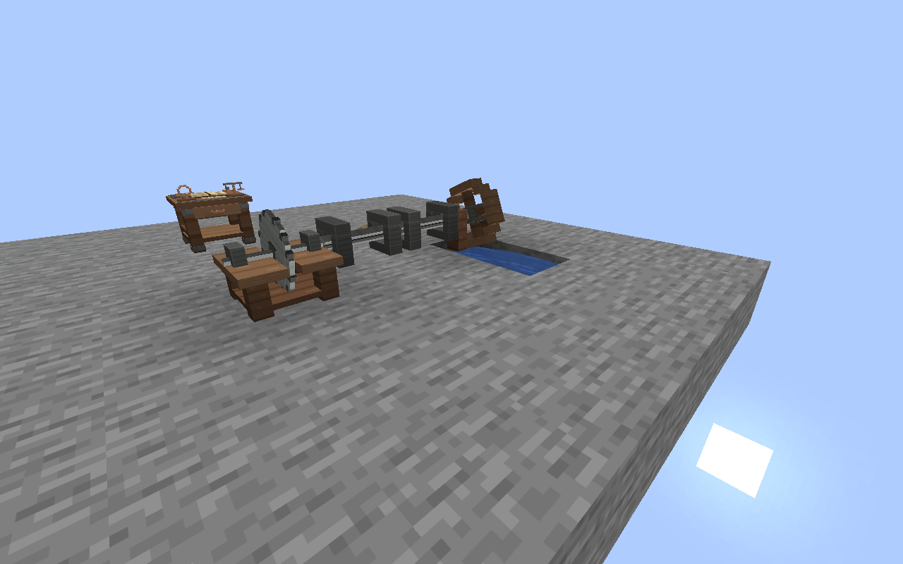
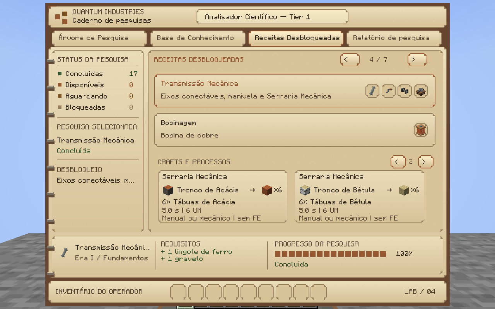
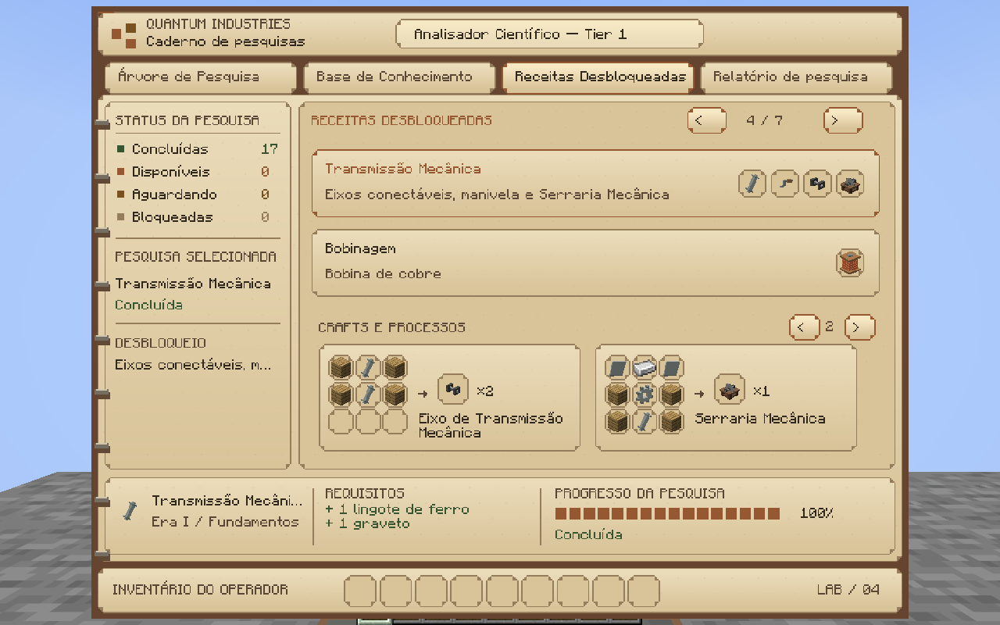
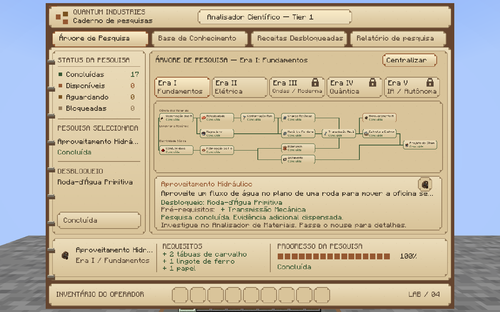

# Oficina mecânica da Era I

## Auditoria e escopo

Base: `main` em `680a9b3` (Minecraft 26.1.2, NeoForge 26.1.2.125, Java 25).
Branch: `feat/era1-mechanical-foundation`. Não integrar automaticamente.

Foram inspecionados os catálogos ResearchCatalog, AssayCatalog,
EmpiricalMaterialCatalog, AssayProfile, WorldResearchData, FoundationRecipe,
ResearchCraftingAccess, ModRecipeBook, a árvore, o caderno, as receitas
desbloqueadas, os registros, a conformação e a infraestrutura de máquinas.
O eixo e a manivela atuais são itens, sem rede mecânica. Os identificadores
e os conhecimentos persistidos serão preservados. A descoberta específica
de prensa mecânica do ferro já sustenta Mecânica Fundamental e não será
substituída por uma exigência de quatro ensaios completos.

O PR #22 foi consultado: permanece aberto e em rascunho. Trefiladora,
recozimento, cabos elétricos e pneumática não são implementados aqui.
Há sobreposição de arquivos em ModItems, ModBlocks, FoundationRecipe,
ResearchCatalog, ResearchTreeView, ResearchTableScreen e traduções. A futura
integração deve combinar registros/entradas, sem substituir catálogos inteiros.
Sistemas pneumáticos e FE não devem ser conectados implicitamente à rotação.
A manivela existente pode ser reutilizada, mas a Trefiladora do PR #22 deverá
adotar explicitamente o contrato mecânico se vier a receber eixos.

## Da ciência à oficina

1. Faça Observação dos Materiais e construa o Analisador de Materiais.
2. Inspecione o ferro e execute a prensa mecânica sobre a amostra. Não é
   necessário completar seus quatro ensaios: a evidência mecânica do ferro
   também pode comprovar Maleabilidade, sem remover as alternativas cobre/ouro.
3. Conclua Maleabilidade, Conformação Manual, Mecânica Fundamental e
   Transmissão Mecânica. Faça Chapas Metálicas para fabricar a serraria.
4. Fabrique engrenagens, o eixo antigo e a manivela. Use o martelo na bancada
   para fazer as chapas. Conhecimentos e descobertas são reutilizados.
5. Consulte o craft da Serraria Mecânica no caderno. O servidor e a prévia
   exigem Transmissão Mecânica **e** Chapas Metálicas; não há condição oculta.

Craft da serraria, da esquerda para a direita:

| Chapa de ferro | Lingote de ferro | Chapa de ferro |
|---|---|---|
| Tábua de carvalho | Engrenagem de ferro | Tábua de carvalho |
| Tábua de carvalho | Eixo mecânico antigo | Tábua de carvalho |

O eixo antigo (`mechanical_shaft`) mantém seu ID e usos anteriores. Para
colocar uma transmissão no mundo, faça `mechanical_shaft_block`: duas linhas
de tábua/eixo/tábua produzem dois blocos. Não há conversão inversa gratuita.
A roda usa seis tábuas de carvalho, duas engrenagens e um eixo antigo.
Nenhum craft novo usa núcleo eletromagnético, FE ou componentes elétricos.

## Controles da serraria

- Coloque-a voltada para você. Suas conexões de eixo ficam nas laterais.
- Clique com uma tora para inserir uma unidade. A fila pode armazenar uma
  pilha do mesmo item; não é permitido misturar espécies na entrada.
- Clique com a manivela para instalar **uma unidade**. Instalações repetidas
  não consomem outras manivelas.
- Mão vazia retira a saída pronta; se não houver saída, gira a manivela.
- Shift + mão vazia retira a entrada e cancela somente seu progresso. Quando
  não houver entrada, retira a manivela, mesmo que existam tábuas na saída.
- A saída fica armazenada. Buffer cheio ou saída de outra espécie pausam o
  trabalho, sem consumir a entrada. Quebrar devolve os itens uma única vez.

Cada receita padrão consome uma tora e produz **seis tábuas correspondentes**
após 100 ticks válidos, contra quatro no crafting vanilla: 50% mais rendimento.
Há onze famílias: carvalho, pinheiro, bétula, selva, acácia, carvalho escuro,
mangue, cerejeira, carvalho pálido, carmesim e distorcida. Os respectivos
blocos de madeira/hifas e variantes descascadas também são aceitos. Bambu não
é tratado como tora: seu rendimento vanilla é diferente.

## Movimento e carga, sem FE

Fonte → eixo alinhado → máquina. Instalar manivela na própria serraria permite
começar sem rede. Também é possível instalar a mesma manivela num eixo.

| Componente | Regra inicial |
|---|---|
| Manivela | 6 UM por até 20 ticks; novo giro a cada 10 ticks; pulsos não se acumulam |
| Roda-d'água | 18 UM enquanto houver contato válido com fluxo |
| Serraria | Carga definida no JSON; padrão 6 UM, um tick de trabalho por tick válido |

UM são unidades de balanceamento, não torque ou grandezas físicas. Potência
excedente não acelera a receita. A soma das cargas deve caber na soma das
fontes: uma roda sustenta três serrarias de 6 UM. Quatro sobrecarregam e
param a rede inteira, sem multiplicação de potência por ramificação/ciclo.

O eixo é orientado pela face clicada: só conecta nas duas extremidades do seu
eixo X, Y ou Z. Uma mudança de 90° exige uma futura peça de transmissão;
eixos perpendiculares não se conectam magicamente. A roda conecta pelo eixo
central; a serraria, pelas laterais. Blocos intermediários interrompem a rede.

A rede é calculada **no servidor**, com deduplicação de posições e cache por
tick/componente. O limite é 256 nós e 8.192 visitas por nível/tick. Rede grande
demais falha fechada; nunca continua com uma fonte parcial. Nenhuma consulta
carrega chunk. Remoção invalida o cache; mudanças de topologia, água ou carga
são reavaliadas no próximo tick, sem contadores de produção no cliente.

## Instalar a roda-d'água

Pesquise Aproveitamento Hidráulico após Transmissão Mecânica. Ele reutiliza a
prensa mecânica do ferro, sem inventar ensaios de água nem novas fichas.

A roda tem eixo horizontal. Água corrente deve tocar uma das quatro posições
do aro no **plano da roda**: acima, abaixo ou nas duas laterais tangenciais.
Uma célula de água não-fonte precisa ter fluxo tangencial mensurável ou estar
em queda (`FALLING`). Água fonte parada, água distante ou fluxo paralelo ao
eixo não alimentam a roda. Os chunks que a consulta de fluxo poderia ler são
conferidos antes dela; não há carregamento indireto de vizinhos.

Exemplo reproduzível: instale a roda com eixo leste/oeste, forneça uma queda
d'água no aro inferior e leve os eixos X até a lateral da serraria. Deixe o
percurso de queda desobstruído e confirme a leitura de 18 UM ao clicar na roda.
Remova o fornecimento de água: a rede para. Reponha: o trabalho retoma.

## Uma fonte para a receita e sua prévia

`MechanicalProcessingRecipe` é um `Recipe<SingleRecipeInput>` registrado,
separado de `FoundationRecipe` (crafts). Seus JSONs em
`data/quantumindustries/recipe/sawing/` declaram alternativas de entrada,
resultado, duração, carga e pesquisa. Usam `ItemStackTemplate`, necessário
para carregar receitas antes de finalizar os componentes de itens no 26.1.

O RecipeManager alimenta a máquina. A sincronização nativa de RecipeType do
NeoForge alimenta o cliente, com cache limpo ao sair e substituído no reload.
A aba Receitas Desbloqueadas mostra somente definições cujos conhecimentos
foram concluídos. As setas inferiores percorrem crafts e processos da pesquisa;
as superiores continuam percorrendo pesquisas. Novos JSONs do mesmo tipo
entram na prévia sem acrescentar tabelas de conversão à GUI.

`MaterialProcesses` associa propriedades qualitativas e adequação a processos
aos materiais existentes. Cobre, ferro e ouro não ganham IDs de amostra novos;
madeira, pedra e combustível são categorias de aplicação, não ensaios novos.
Essa informação não implica que o jogador conhece a técnica: a autorização
continua em WorldResearchData/AssayProfile. O cadastro de conformação existente
não recebe um novo bloqueio, preservando extensão futura para itens aquecidos.

## Persistência e segurança

Entrada, saída, progresso, ID da receita, UUID do operador, manivela e amostra
de rotação são persistidos na Block Entity. Um processo em andamento continua
vinculado ao conhecimento do operador que iniciou a fila; desconectar esse
jogador não apaga o conhecimento salvo. Limpar seu conhecimento suspende novos
ticks de trabalho. Outro jogador qualificado pode compartilhar a máquina,
retirar a entrada e iniciar sua própria fila. Não recebe pesquisas por usá-la.

Inserção, extração, giro e consumo são serializados no thread do servidor.
O cliente apenas anima a geometria sincronizada. A lâmina para sem movimento
válido; eixos e roda têm rotores reais, sem substituição por partículas.
Arquivos editáveis: `design/mechanical/*.bbmodel`; textura original em
`assets/quantumindustries/textures/block/mechanical_workshop.png`.

## Verificação reproduzível

```text
./gradlew build
python -X utf8 -m unittest discover -s tests -v
# Windows, JDK 25 e cache local:
powershell -ExecutionPolicy Bypass -File tools/verify-mechanical.ps1 -Offline
# Linux, JDK 25:
bash tools/verify-mechanical.sh
```

Cada execução cria um mundo novo em `build/mechanical-verification/runs/` e
inicia o servidor **duas vezes** no mesmo save. Os logs, resultados e NBTs
ficam ali; os saves de `run/` não são usados. O roteiro aprende as pesquisas
pelo menu, executa os ensaios relevantes do ferro e fabrica a oficina no modo
survival com suprimentos de teste preparados. Não usa desbloqueio administrativo
no jogador principal. Um segundo operador recebe conhecimentos como fixture
somente para o teste separado de concorrência/autorização.

A execução local final `20261106-190239` passou em 201 verificações na gravação e
156 na retomada: ciência, custos, crafting, conformação, rendimento das onze
famílias, manivela, sobrecarga, retirada de entrada/saída, quebra, expiração,
reinício do servidor e descarregamento/recarga reais de chunk. O diagnóstico
de chunk aguarda o descarregamento efetivo; não confunde uma readmissão rápida
do mesmo objeto com perda de inventário. O verificador Java puro cobre ciclos,
limites e conservação de capacidade; os testes Python cobrem recursos e dados.
Os 23 testes Python passaram, assim como a regressão dedicada do dínamo,
evidências de pesquisa, bloqueios individuais de crafting e livro vanilla.

O preview gráfico é separado: `tests/mechanical-preview.init.gradle`, mundo
MechanicalQA e capturas em `build/mechanical-preview/screenshots/`. Ele usa
câmera espectadora e desbloqueios só para exibir a interface; **não** é evidência
de uma partida survival manual. O teste automático em survival também não
equivale a uma sessão humana coletando todos os recursos desde o spawn.

O cliente real recebeu os onze processos e produziu as capturas abaixo, com
modelos, textura, animação e caderno carregados pelo jogo. A fixture gráfica
usa desbloqueios administrativos apenas para enquadrar todos os elementos.






Para reproduzir o preview, copie o diretório `world` de uma execução completa
do verificador para `build/mechanical-preview/saves/MechanicalQA` (sem
`playerdata`) e execute `./gradlew --init-script
tests/mechanical-preview.init.gradle runClient`. A fixture encerra o cliente
após capturar e verificar o caderno; o resultado explícito fica em
`build/mechanical-preview/preview-result.txt`. A janela fica oculta para não
interromper o uso do computador. A CI executa o roteiro de servidor em duas
inicializações e depois compila novamente o JAR normal, sem classes de QA.

## Roteiro de revisão humana

Num survival novo, siga a cadeia científica acima, reúna os materiais, fabrique
a serraria e confira sua grade 3×3 no caderno. Produza seis tábuas manualmente.
Depois fabrique a roda e os eixos, alinhe-os e use água em movimento para a
produção contínua. Deixe entrada/saída na máquina, feche e reabra o mundo e
confira a retomada. Durante uma operação, remova um eixo e depois a água;
verifique a pausa e a retomada, sem tábuas extras. Repita com dois clientes
conectados e conhecimentos diferentes. Registre separadamente essa sessão:
ela não está declarada como uma coleta survival humana aprovada.

## Limitações e próximas entregas

Não há engrenagem de canto, perdas, atrito, inércia, multiplicação de velocidade,
funil/automação de inventário, motor ou adaptação FE neste estágio. Modelos
são voxel de oficina, não versões elétricas. Máquinas elétricas preexistentes
continuam disponíveis, mas não receberam novos sistemas nesta branch.

Planejados: Moinho de Pedra, Prensa Mecânica de Fuso, Guincho de Mineração,
Bomba Mecânica, transmissões avançadas e evolução elétrica na Era II. Nada
disso está marcado como implementado. Um futuro motor pode fornecer capacidade
pelo contrato rotacional; sua conversão de FE deverá ser explícita.
