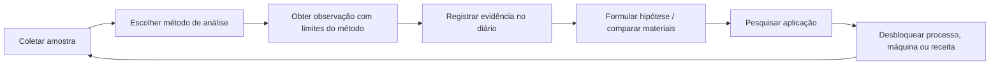
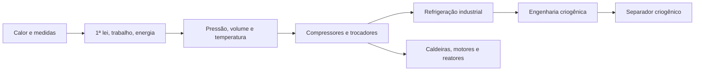
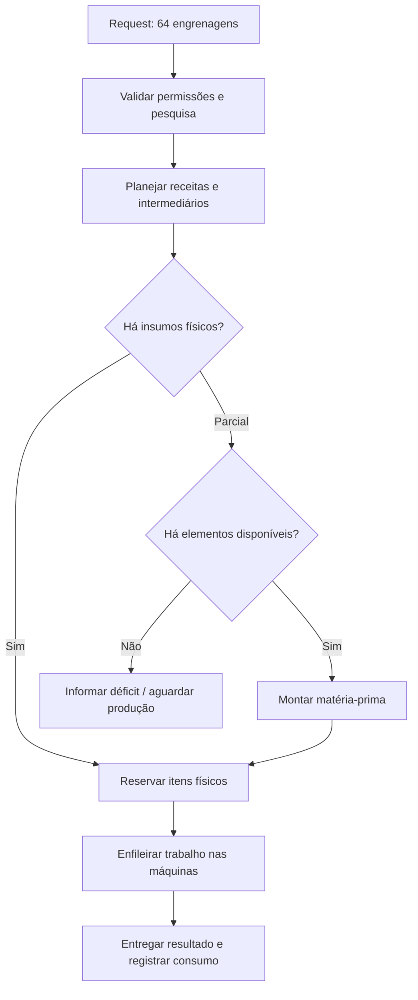

# QUANTUM INDUSTRIES — Game Design Document (GDD)
**Versão:** 0.1 — proposta de design, 2026-11-07  
**Status:** em discussão; NÃO representa funcionalidades já implementadas.  
**Escopo:** prólogo do meteorito até o Quantum Computer.  
**Trabalho relacionado:** [Roadmap Mestre](ROADMAP_QUANTUM.md) · [Issue #25](https://github.com/Vizinho-hn/Quantum-Industries/issues/25).

## 1. Resumo executivo

**Premissa:** em Minecraft, o jogador encontra tecnologia desconhecida dentro de um meteorito, recebe um **Manual de Campo**, aprende experimentação científica realista e constrói uma indústria progressivamente mais sofisticada. Mais tarde compreende materiais, processa atmosferas dimensionais, armazena *equivalentes de elementos* e comanda uma fábrica automatizada por meio de um Quantum Computer.

**Fantasia do jogador:** de investigador curioso a arquiteto de uma infraestrutura científica capaz de organizar e transformar a matéria.

**Identidade:** a progressão depende de conhecimento demonstrado e da infraestrutura correta. Não basta possuir um item, nem alcançar um nível arbitrário de XP.

**Cinco eras oficiais (preservadas):**
1. Engenharia Mecânica e Ciência Empírica.
2. Revolução Elétrica.
3. Ondas Eletromagnéticas e Tecnologia Moderna.
4. Engenharia Quântica.
5. Inteligência Artificial e Automação Autônoma.

Química, metalurgia, termodinâmica, instrumentação, análise de materiais, atmosfera e armazenamento de matéria são **linhas científicas transversais**, alocadas em pontos das eras conforme suas dependências.

## 2. Princípios de design e limites

| Pilar | Regra verificável |
|---|---|
| Ciência por evidências | Métodos diferentes revelam dados diferentes. Resultado negativo não é “identificação automática”. |
| Conhecimento separado de inventário | Ter quartzo no bolso não equivale a saber que contém silício e oxigênio. |
| Industrialização em camadas | Processos avançados exigem infraestrutura, trabalho, tempo e energia. |
| Consistência dos materiais | Não inventar cobre do ar nem transformar qualquer coisa numa moeda de EMC universal. |
| Preservação do Minecraft | Exigências científicas devem dar objetivos jogáveis; não virar um simulador laboratorial excessivamente lento. |
| Mundo persistente | Não destruir construções, duplicar recursos ou conceder progresso inadvertidamente ao carregar mundo/servidor. |
| Multiplayer | Progressão por jogador, infraestrutura compartilhada com políticas de acesso e recompensas de tutorial por participante. |

### Fronteira entre ciência e ficção

| Mecânica | Fundamentação |
|---|---|
| Ensaios, HCl e carbonatos, eletricidade, ligas, termodinâmica | Ciência e indústria estabelecidas; gameplay abstrai detalhes. |
| Raman/laser e identificação de amostras | Instrumentação real, com limitações e métodos complementares. |
| Coleta de gases, destilação criogênica, separação de componentes | Tecnologia real; composições de Nether/End são ficção de design. |
| Organização e manipulação atômica | Manipulação pontual existe; fabricação universal industrial não. |
| Banco Atômico → reconstrução sob demanda de matérias-primas | Extrapolação **ficcional**: manter custo, limites e regras internas consistentes. |
| Quantum Computer com autocrafting | Planejamento industrial é possível com computação clássica; o supercomputador “quântico” é uma ferramenta fictícia de endgame. |

## 3. Jornada de experiência (primeiros 30–60 minutos; metas, não tempos garantidos)

**Experiência pretendida:**
1. Céu ilumina; meteorito passa e uma cratera aparece em região segura nas proximidades.
2. O jogador nota fumaça, fragmentos e um objeto metálico diferente dos minerais.
3. Ao abrir o **Cofre de Origem**, recebe um **Manual de Campo** individual, com mensagem intrigante e primeira tarefa clara.
4. Manual propõe explorar/inspecionar uma amostra comum e registrar uma observação.
5. O jogador monta Mesa de Pesquisa Tier 1, aprende **Observação dos Materiais** e constrói a Bancada de Ensaio Empírico.
6. Um teste pode ser inconclusivo, mas gera registro válido; experiências apropriadas permitem pesquisa aplicada.
7. Começa oficina mecânica, constrói transmissão e obtém o Dínamo Manual — primeiro marco industrial.

**Tom narrativo:** mistério discreto, sem revelar cedo origem cósmica e sem prender o jogador a uma quest linear. A **tecnologia do cofre não entrega a ciência pronta**: oferece ferramentas pedagógicas iniciais e provoca investigação.

### Exemplo de texto do Manual
> “Os materiais não guardam seus segredos à vista. Registre o que observa; repita o que puder medir. Se uma amostra nada revelar, talvez seja o instrumento que ainda não faz a pergunta certa.”

## 4. Sistema de Prólogo — Meteorito, Cratera e Cofre

### 4.1 Regras do evento

**Evento de mundo:** disparado **uma vez por mundo** quando há um jogador em condições seguras. Não em todo login, morte ou entrada de outro jogador. A persistência é server-authoritative.

- **Fase 1: planejamento do local.** Preferir terreno estável, carregável, não protegido e sem estruturas críticas; registrar posição antes de mostrar a cena. Prevenir conflitos com spawn, vilas, claims e construções.
- **Fase 2: apresentação.** Efeito visual/sonoro de objeto atravessando o céu, tela/partículas e impacto sem física explosiva destrutiva real. Não criar incêndios em cadeia.
- **Fase 3: estrutura.** Posicionar cratera pequena e cofre com regras controladas; se não houver local elegível, usar uma alternativa previsível não destrutiva.
- **Fase 4: descoberta.** Waypoint, rumor visual ou bússola do manual opcional. Não impedir gameplay vanilla.
- **Fase 5: cofre.** Interação com servidor concede livro individual uma vez, registra conclusão do primeiro objetivo e dá acesso ao tutorial.

**Resiliência:**
- Flag global: `meteor_event_state` = `not_started|planned|placed` + UUID/localização da estrutura; reiniciar durante spawn não cria uma segunda cratera.
- Por jogador: `onboarding_started`, `book_claimed`, `tutorial_steps`, independentes do evento global.
- Duplicação de livro é aceitável se for item informativo não vendável, mas não pode conceder duplicação de itens/XP/recompensas.
- Livro perdido: receita de recuperação barata, comando de recuperação ou acesso à versão digital na Mesa de Pesquisa.
- Múltiplos jogadores podem consultar o mesmo cofre; não usar loot consumível de baú normal como única origem do livro.
- Novo mundo: meteorito opcional por configuração; mundo já existente: opt-in/geração assistida, nunca impacto automático em base criada.
- Plano B sem renderização da cinematic / máquinas modded / servidor dedicado: o cofre e tutorial continuam acessíveis.

**Detalhe:** chamar **Cofre de Origem** evita confundir com o `vault` vanilla das Trial Chambers; implementá-lo como bloco próprio com interface, textura e estado próprios.

### 4.2 Missões do tutorial

| Etapa | Ação | Feedback | Recompensa pedagógica |
|---|---|---|---|
| T0 — A queda | Localizar a cratera | Efeitos e marco no mapa | Acesso ao cofre |
| T1 — Primeiro registro | Obter Manual de Campo | Livro aberto com missão | Página “observação” |
| T2 — Ciência empírica | Inspecionar material em bancada | Resultado registrado | Mostrar evidência versus hipótese |
| T3 — Pesquisa aplicada | Aprender Observação dos Materiais e uma pesquisa simples | Árvore marca como aprendido | Receita desbloqueada |
| T4 — Oficina | Construir transmissão/primeiro mecanismo | Máquina trabalhando | Página “trabalho e movimento” |
| T5 — Energia | Operar Dínamo Manual | Indicador de energia | Encerramento do capítulo introdutório |

*O tutorial não concede automaticamente desbloqueios de pesquisas: observa eventos reais validados pelo servidor.* Conteúdo pode apontar a mecânicas já existentes mesmo que a ordem fina seja revisada.

### 4.3 Aceite do prólogo
- Evento único após reload e em login simultâneo.
- Sem dano involuntário a base/spawn; evento desabilitável/recuperável.
- Dois jogadores obtêm livro sem tirar o livro um do outro.
- Tutorial prossegue normalmente sem cinematic; livro pode ser recuperado.
- Não desbloqueia receita protegida apenas por assistir à cena.

## 5. Loop científico



### 5.1 Conhecimentos
- **Observação:** o que o equipamento mediu, com resultado positivo, negativo ou inconclusivo.
- **Identificação:** classificação do material apoiada por um conjunto de evidências.
- **Propriedade:** condutividade, resposta ao ácido, magnetismo, composição etc.
- **Pesquisa:** converte conhecimentos em aplicações.
- **Blueprint de material:** conhecimento de composição + estrutura + rota de processamento, separado de receita de item complexo.
- **Relatório:** meio de compartilhar achados entre jogadores sem conceder automaticamente proficiência de operação.

### 5.2 Material Analyser
- **MK1:** a `empirical_assay_bench` existente oferece 4 métodos a 10 materiais; manter IDs e 40 descobertas persistidas. Nome “MK1” aqui é design de progressão, não renomear IDs existentes.
- **MK2:** análise instrumental, por exemplo laser/Raman, óptica e medições físicas. Capaz de identificar certos materiais que MK1 não distingue.
- **MK3:** análise elementar e estrutural avançada; identifica proporções e guarda blueprint de matérias-primas quando a técnica permite.

**Caso exemplificador — quartzo:** reação com HCl diluído sem bolhas não identifica quartzo; assinatura Raman adequada pode identificá-lo; análises avançadas podem caracterizar `SiO₂` e propriedades cristalinas. Composição igual não garante mesma estrutura: grafite e diamante.

**Não confundir** `Material Analyser MK1/MK2/MK3` com as **Mesas de Pesquisa Tier 1/Tier 2** existentes.

## 5A. Ciência Aplicada ao Cotidiano — progressão com escala proporcional

**Princípio de design aprovado:** nem toda pesquisa precisa desbloquear algo grandioso. A ciência também serve para fazer pão melhor, reduzir desperdícios, melhorar ferramentas e poupar trabalho. **O custo de descobrir uma tecnologia deve ser proporcional ao benefício dela**, sem burocracia repetitiva.

### 5A.1 Três escalas de invenções

| Escala | Exemplos | Esforço científico desejado | Resultado |
|---|---|---|---|
| **Cotidiana** | Moedor de trigo, pão melhorado, forno mais eficiente, recipientes, filtros simples | 0–1 investigação curta + materiais comuns; sem árvore exclusiva de várias pesquisas | Qualidade de vida, rendimento, alimento, conveniência |
| **Industrial** | Moedor elétrico, óptica de precisão, compressores, motores, refrigeração | Várias descobertas já úteis em outras cadeias + equipamento específico | Novos processos ou automação |
| **Transformadora** | MK3, Banco Atômico, montagem programável, Quantum Computer | Múltiplas disciplinas, infraestrutura e experimentos significativos | Nova categoria de tecnologia |

- **Não transformar cada receita em um nó** na árvore científica. Variações de produtos podem aparecer como receitas derivadas de **uma capacidade** já aprendida.
- Descobertas comuns não precisam levar a uma invenção impressionante; algumas servem exclusivamente à agricultura, alimentação, construção ou conforto.
- Repetir um processo conhecido é produção industrial normal, não um experimento que deva ser refeito por item.

### 5A.2 Primeira cadeia cotidiana: do trigo ao pão

**Exemplo proposto (não implementado):**


- O **Moedor Manual** deve ter uma pesquisa simples sobre moagem/granulometria ou ser liberado por uma descoberta inicial já existente, exigindo ingredientes comuns, sem inventar muitas dependências.
- A **Farinha** é um intermediário aproveitável em culinária; o **Pão melhorado** pode oferecer melhor saturação ou maior rendimento que o pão vanilla, **após balanceamento** para evitar criar alimento superior gratuito.
- Evolução natural: moedor manual → versão elétrica com mesma função e mais produção/conveniência; não exigir uma segunda descoberta de que “trigo moído vira farinha”.
- A moagem de minérios pode reutilizar o **conhecimento geral sobre redução de partículas**, mas exige ferramenta, peças e receitas industriais apropriadas; não presumir que uma máquina alimentar deve triturar minérios metálicos.
- **Critério de aceite:** jogador consegue produzir o pão usando ferramentas de começo de jogo, com no máximo uma descoberta curta, sem bloquear o progresso científico principal.

### 5A.3 Experimentos enxutos com variáveis controladas

- **Básico:** escolher amostra + método, observar o resultado.
- **Intermediário:** alterar **uma variável relevante** (temperatura, pressão, concentração ou tempo) e comparar 2–3 condições com feedback visível.
- **Avançado:** combinar um conjunto pequeno de instrumentos e condições; oferecer modos recomendados e um modo livre opcional para curiosos.
- Evitar sliders sem consequência, dezenas de repetições e RNG sem explicação. A descoberta ocorre uma vez por jogador; automatizar o processo depois.
- Resultados negativos e inconclusivos ficam no caderno, mas **não** abrem conhecimentos que o teste não mediu.
- **Métricas de UX sugeridas:** número de ações por descoberta, testes abandonados, tempo até fabricar primeiro objeto útil, proporção de experimentos repetidos sem ganho.

### 5A.4 Óptica e vidraria — avanço útil e reaproveitável

- Trabalhar vidro → lente/prisma → lupa/instrumentos ópticos → componentes do MK2.
- Cada objeto novo deve oferecer uma função observável: ampliar detalhes, focalizar luz, detectar assinatura espectral ou calibrar um equipamento.
- Não criar uma árvore independente com dezenas de nós só para fabricar uma lente; compartilhar pesquisas de materiais, geometria e instrumentação já existentes.
- Materiais/resistências para vidraria de laboratório podem avançar conforme a química, sem simular perigos reais em detalhes operacionais.

### 5A.5 Projetos Científicos leves (inspiração em Dr. Stone)

Um **Projeto Científico** é uma camada de objetivos que **consulta** a árvore de pesquisas existente; não deve duplicar a árvore, conceder conhecimento gratuitamente nem exigir um novo sistema complexo de progressão.

- Definição por dados: `ProjectDefinition {id, title, requirements[], milestoneOutputs[], optionalHints[]}`.
- Na primeira versão, um projeto é apenas uma **visão agregada** de requisitos já disponíveis, com marcação automática quando pesquisas/receitas/eventos atuais forem validados no servidor.
- Exemplos: **Primeira Padaria Mecanizada** (moedor + farinha + pão), **Primeira Rede de Comunicação** (energia + bobinas + sinais), **Decifrar o Sinal do Meteorito** (receptor + registros instrumentais).
- Projetos **não são obrigatórios para cada invenção**. Usar para iniciativas médias/grandes e para guiar o jogador perdido.
- Como evolução futura, projetos podem registrar protótipos, mas o MVP só precisa de lista contextual e progresso vinculado às pesquisas atuais.
- Sem recompensas duplicadas por pesquisar o mesmo princípio via dois projetos.

### 5A.6 Rede de Descobertas com divulgação progressiva

- A rede é um **grafo interno de evidências, conceitos e aplicações**; a UI **não** mostra todos os nós e arestas.
- No caderno, a descoberta exibe apenas: **o que foi observado**, **uma aplicação disponível**, **até 1–2 aplicações futuras relevantes**, e **onde aprender mais**.
- Mostrar outras aplicações sob pedido do jogador (`Ver usos relacionados`), busca, filtros por área e páginas temáticas — não um enorme mapa com 200 nós bloqueados.
- Reutilizar conhecimento quando fizer sentido: **moagem** conecta padaria e britagem, **resfriamento** conecta refrigeração e criogenia, sem prometer que toda pesquisa desbloqueia dez coisas extraordinárias.
- Não colocar avisos/tutoriais repetidos para cada nova receita: destaque automático apenas para mudanças que afetam objetivos atuais ou missões escolhidas.

### 5A.7 Amarração narrativa: o meteorito continua relevante

O **Cofre de Origem** e o sinal misterioso podem oferecer um arco opcional de longo prazo: observar no MK1 → estudar propriedades no MK2 → caracterizar parte da composição no MK3 → investigar mais profundamente com o Quantum Computer. Cada retorno fornece uma pista ou uma nova pergunta, **sem transformar o cofre em fonte de desbloqueios mágicos**. O mistério não impede o jogador de construir uma padaria ou uma oficina e aproveitar o cotidiano do Minecraft.

### Aceite desta diretriz

- [ ] Primeiro exemplo de descoberta cotidiana: **moedor manual, farinha e pão melhorado**; versão elétrica como melhoria futura.
- [ ] Um experimento intermediário pode ser concluído com **2–3 comparações relevantes**, sem tentativas repetitivas obrigatórias.
- [ ] Um Projeto Científico reaproveita **pesquisas já existentes**, sem duplicar progresso e sem segunda árvore complexa.
- [ ] Uma descoberta mostra poucas aplicações contextuais na UI; ligações adicionais somente sob demanda.
- [ ] Linha de vidraria/óptica apresenta usos reais antes de entrar no MK2.
- [ ] O mistério do meteorito cresce por evidência e continua opcional no loop cotidiano.

## 6. Cinco eras e linhas transversais

### Era I — Mecânica
Aprender a medir e comparar → ferramentas e bancada empírica → conformação → serraria → transmissão → roda-d'água → dínamo.

### Era II — Eletricidade
Indução → armazenamento galvânico → cabos/conduítes → instrumentação e prensas elétricas → base de energia para processos térmicos.

### Era III — Ondas e modernidade
Eletrônica e controle + química aplicada + termodinâmica + gases industriais + início de caracterização instrumental. Sem apagar a identidade original de ondas/sinais/controle.

### Era IV — Engenharia Quântica
MK2/MK3 avançados, pureza, estrutura cristalina, propriedades materiais, descoberta de rotas para reconstrução, experimentos de matéria programável.

### Era V — IA e automação
Banco Atômico e montadores amadurecem; Quantum Computer integra pedidos, redes, controle de processos e autocrafting completo.

### Árvore de Termodinâmica



Cada nó requer **experimento demonstrável**, não apenas materiais em inventário. Compressão normalmente aquece gases; resfriamento envolve troca de calor, expansão e ciclos de refrigeração. A destilação separa componentes por suas diferentes volatilidades, não por “centrifugar o ar”.

## 7. Cadeias de matéria

### 7.1 Mineração e ligas
- Cobre vanilla + estanho de cassiterita → bronze.
- Cobre vanilla + zinco de esfalerita → latão.
- Chumbo e enxofre podem entrar somente quando receitas/tecnologias os exigirem.
- Cadeias incluem obtenção, processamento e perda, não “spawn de lingote”.
- Priorização: adicionar **somente recursos com uso e fonte em survival**.
- Item **âmbar** só precisa existir caso a receita exija a substância; cor âmbar do frasco não prova ingrediente.

### 7.2 Atmosfera
**Máquinas:** Coletor Atmosférico → tanque bruto → purificador → compressor + resfriador → separador criogênico (ou outro método viável) → tanques de gases → indústria química ou dissociação de endgame.

**Mecânica dimensional:**
- `dimensionAtmosphereProfile`: gases, proporções, pressão, temperatura, impurezas, rendimento, filtragem e condições de operação.
- Overworld inspirado na Terra. Nether e End usam composições *de ficção do mod*, não oficiais.
- Custo **total** superior nas dimensões mais avançadas por decisão de balanceamento, com filtros especiais, energia e infraestrutura; não atribuir causalidade física inventada.
- O coletor **não retorna elementos isolados**; separação dá moléculas gasosas, como `N₂` e `O₂`. Converter para equivalentes atômicos exige etapa avançada e custo.
- A atmosfera não fornece metais arbitrários nem quantidades sem limite de vazão.
- Sem atmosfera configurada → sem produção e com erro explicativo.

## 8. Banco Atômico, decomposição e montadores

**Descrição curta:** sistema parecido com a conveniência do EMC, mas com inventário separado por elementos. **Não é uma moeda de transmutação universal.**

**Processos:**
1. Decompositor analisa insumo permitido, consome energia e o transforma em **equivalentes elementares** com perdas e subprodutos registrados.
2. Banco Atômico acumula `C`, `Fe`, `Cu`, `Sn`, `O`, `Si` etc. como unidades escaladas fisicamente coerentes (massa/mol), não como átomos livres mantidos em recipientes.
3. Montador de Matéria consulta blueprint pesquisado, confere elementos, energia e tempo e reconstrói apenas **matéria-prima** ou insumos químicos básicos.
4. Construção de máquinas, engrenagens e circuitos continua nas fábricas industriais, com receitas e equipamentos.

**Conservação:** entradas/saídas em unidades normalizadas com arredondamento controlado; nenhuma receita pode criar saldo ao repetir ciclo `item → decomposição → montagem → item`. Transações server-side, com reserva e rollback.

**Exemplo:** estoque C e Si não autoriza criar qualquer item de carbono/silício; é preciso conhecer as estruturas e rotas. Para fabricar uma engrenagem de bronze, produzir cobre/estanho (se faltarem), fundir bronze e usinar a engrenagem numa máquina.

## 9. Quantum Computer e logística

**Três domínios controlados:** `Inventário Físico`, `Banco Atômico`, `Conhecimento/Blueprints/Receitas`.

**Fluxo do pedido:**


**Requisitos:** jobs persistentes, controle de acesso, prevenção de duplo débito, priorização e cancelamento, retomada após restart, ciclos de receita detectados, energia demonstrada e indicadores de gargalo. A ligação com a coleta atmosférica permite reabastecer certos elementos sem exigir coleta direta pelo jogador.

**Compatibilidade AE2:** o mod deve funcionar sozinho; integração futura opcional via APIs, se versões/licenças permitirem. A inspiração não implica copiar código/recursos.

## 10. Modelo de dados proposto (orientativo)

```text
MaterialDefinition
  id, sources[], properties[], allowedProcesses[], units
AnalysisMethod
  id, requiredDevice, observations[], accuracyLimits
MaterialDiscovery
  playerId, materialId, methodId, outcome, evidenceId, timestamp
ResearchNode
  id, requiredEvidence[], priorResearch[], outputs[]
MaterialBlueprint
  materialId, elementRatios{}, structureClass, purityTier, synthesisRoute
DimensionAtmosphereProfile
  dimensionId, components{}, environment{}, hazards{}, processingModifiers
AtmosphericBatch
  composition{}, amount, originDimension, purity, contamination
AtomicStorage
  networkId, balances{}, reservations{}, transactionLog
CraftingJob
  jobId, playerId, requestedItem, quantity, plan, allocations, state
OnboardingState
  worldMeteor{state,craterPos}, player{bookClaimed,steps[]}
```

**Responsabilidades:** progressão científica persiste por jogador. Máquina, energia e estoque persistem no mundo/rede com autorização. Um jogador não “empresta automaticamente” seus desbloqueios à rede sem uma política explícita.

**Validação:** estruturas, recipes, loot, eventos e saved data devem se ajustar à versão efetiva do NeoForge/Minecraft do projeto, sem presumir APIs exatas por antecipação.

## 11. UI / UX e documentação in-game

**Manual de Campo:** páginas por capítulo e índice de evidências; navegação `Origem → Ciência → Oficina → Energia → Química → Termodinâmica → Materiais → Quantum`. Exibir **“observado”**, **“hipótese”**, **“confirmado”** e **“não investigado”** como estados visuais distintos.

**Bancadas:** resultado com método, amostra e conclusão efetiva; negativos e inconclusivos podem ser registrados sem desbloquear tecnologia. Equipamentos posteriores mostram o que acrescentam em relação ao MK1.

**Rede:** tela Quantum Computer com estoque físico, estoque atômico, jobs, limites, energia, faltas e motivos pelos quais um request está bloqueado.

**Acessibilidade:** efeitos da queda opcionais, fontes legíveis, cores não como único indicador, navegação por teclado/controlador conforme viabilidade e onboarding que não prende o jogador.

## 12. MVPs, ordem de produção e prioridades

| Iteração | Prova jogável | Risco principal |
|---|---|---|
| P0 | Cofre de Origem e livro, sem cinematic destrutiva | geração segura e multiplayer |
| P1 | Tutoriais ligados aos experimentos existentes | quebra da persistência atual |
| P2 | Minérios estanho/zinco e bronze/latão em survival | inflar catálogo sem propósito |
| P3 | Experimento de gases → compressor → refrigeração | UI/processamento complexo |
| P4 | Coletor Overworld → tanque → separação realista | balanceamento de gás/energia |
| P5 | Análise MK2/MK3 do quartzo | provas científicas e dados corretos |
| P6 | Decompor e remontar uma matéria-prima | duplicação ou conversão sem conservação |
| P7 | Quantum Computer faz request de uma engrenagem | scheduler e persistência |
| P8 | Redes dimensionais e automação escalável | infraestrutura e performance |

**Prioridade prática:** P0/P1 antes do cinematográfico definitivo; P2 antes de minério demais; P6 precisa de testes de conservação antes de qualquer farm automática. Não paralelizar todas as eras sem interfaces de dados estáveis.

## 13. QA, métricas e critérios de aceite

### Testes obrigatórios
- [ ] Criar mundo novo com meteorito; reload não cria duplicata.
- [ ] Área protegida / base próxima: sem danos; alternativa de spawn executada.
- [ ] Dois jogadores abrem o mesmo cofre e cada um recebe seu manual.
- [ ] Manual perdido pode ser recuperado sem repetir recompensa de recursos.
- [ ] Mundo legado não sofre impacto automático.
- [ ] Teste com HCl em quartzo não revela sua composição.
- [ ] MK2 pode identificar quartzo por método apropriado; MK3 distingue composição e estrutura.
- [ ] Separador criogênico requer pesquisa térmica validada.
- [ ] Atmosferas diferentes produzem misturas distintas, com custo dimensional balanceado.
- [ ] Decomposição/reconstrução não aumenta massa equivalente em ciclo fechado.
- [ ] Um item complexo é fabricado pela rede de máquinas, não diretamente no Banco Atômico.
- [ ] Jobs retomam após servidor reiniciar sem duplicar recursos.
- [ ] 40 descobertas e progressão existentes são preservadas em saves antigos.

### Telemetria opcional de desenvolvimento (local, sem dados pessoais)
Tempo até encontrar cratera; desistências do prólogo; testes inconclusivos; tempo até primeiro dínamo; FE consumidos por kg/unidade de gás; proporção de componentes faltantes no autocrafting; falhas por erro de receita. Usar para ajustar legibilidade e progressão.

## 14. Riscos e decisões abertas

1. **Meteorito bonito versus mundo intacto:** preferir estrutura + cinematic não destrutiva.
2. **Tutorial versus liberdade:** o livro sugere objetivos; vanilla continua jogável.
3. **Nível dos aparelhos versus nível da pesquisa:** métodos instrumentais e autorização distintos do progresso científico.
4. **Nível de rigor científico:** abstrair operações perigosas/complexas em receitas e resultados, sem dar instruções laboratoriais reais de produção de substâncias perigosas.
5. **Realismo do Banco Atômico:** representar como ficção sustentada por limites internos e recursos físicos.
6. **Economia versus automação:** evitar que coleta atmosférica substitua mineração e que o computador ignore a indústria.
7. **Multiplayer:** cofre individual na coleta, infraestrutura autorizável, ciência pessoal.
8. **API/mod-loader:** confirmar a implementação real antes de escolher hooks de estrutura, eventos, menus e persistência.

## 15. Definição de sucesso

Uma pessoa sem conhecer o mod encontra o meteorito, entende como gerar uma observação, descobre algo que sua ferramenta inicial não mede, usa conhecimentos para desenvolver máquinas, constrói uma cadeia atmosférica e, no endgame, solicita uma peça complexa ao Quantum Computer — **que obtém matérias-primas e coordena a indústria para produzi-la**, sem atalhos mágicos universais.

---

**Estado do documento:** proposta para revisão e implementação incremental. *Nenhum item deste GDD representa commit de funcionalidade executável.*
