# Catálogo Visual de Itens, Componentes e Máquinas

**Quantum Industries — Guia Técnico e Visual de Engenharia**

Este catálogo documenta visualmente todos os itens, instrumentos de ensaio, componentes estruturais e maquinários industriais implementados nas Eras I e II do Quantum Industries.

---

## 📑 Índice por Disciplina

1. [🔬 Instrumentos Científicos e Metrologia Empírica](#1--instrumentos-científicos-e-metrologia-empírica)
2. [🔨 Metalurgia, Conformação e Materiais](#2--metalurgia-conformação-e-materiais)
3. [⚙️ Oficina Mecânica e Transmissão Cinética](#3--oficina-mecânica-e-transmissão-cinética)
4. [⚡ Geração, Armazenamento e Distribuição Elétrica](#4--geração-armazenamento-e-distribuição-elétrica)
5. [🧪 Hidráulica, Pneumática e Reagentes](#5--hidráulica-pneumática-e-reagentes)
6. [📜 Documentação e Base de Conhecimento](#6--documentação-e-base-de-conhecimento)

---

## 1. 🔬 Instrumentos Científicos e Metrologia Empírica

Instrumentos portáteis utilizados nos ensaios do Analisador de Materiais (Bancada Empírica) e no diagnóstico em tempo real de circuitos e máquinas.

| Foto | Nome & ID | Descrição Científica | Aplicação Técnica |
| :---: | :--- | :--- | :--- |
|  | **Lupa de Vidro** `quantumindustries:magnifying_glass` | Lente biconvexa de alta pureza ótica montada em suporte de latão. | **Ensaio Óptico:** revela microfraturas, clivagem e cristalografia nas amostras da bancada empírica. |
| 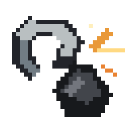 | **Kit de Ensaio de Chama** `quantumindustries:flame_test_kit` | Fio de platina/níquel e cadinho para espectroscopia de emissão atômica por combustão. | **Ensaio Térmico:** identifica cátions metálicos pela cor característica emitida na chama (ex: cobre verde). |
|  | **Fole Manual** `quantumindustries:manual_bellows` | Fole de couro costurado com bocal de bronze para injeção forçada de ar. | **Ensaio Pirométrico:** intensifica a oxigenação da forja, elevando a temperatura de fusão e recozimento. |
|  | **Frasco de Ensaio** `quantumindustries:assay_flask` | Frasco volumétrico de borossilicato graduado resistente a ácidos. | **Ensaio Químico:** reações de lixiviação e dissolução de precipitados em solventes controlados. |
|  | **Pesos de Calibração** `quantumindustries:brass_weights` | Conjunto usinado de pesos de precisão em liga densa para balança analítica. | **Gravimetria:** determina densidade volumétrica e massa específica comparativa de minerais. |
| 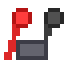 | **Sondas de Teste** `quantumindustries:test_probes` | Par de eletrodos com pontas pontiagudas de contato para medição ôhmica. | **Inspeção de Sinais:** testa continuidade e resistência elétrica direta em barramentos e componentes. |
|  | **Óculos de Inspeção Energética** `quantumindustries:energy_inspection_goggles` | Armação industrial de couro com oculares de latão e lentes sintonizadas de campo. | **HUD de Rede:** ao olhar para blocos elétricos a até 6 blocos, projeta fluxo (FE/t), buffer e perdas térmicas. |

---

## 2. 🔨 Metalurgia, Conformação e Materiais

Ligas conformadas a frio e a quente, condutores elétricos e elementos estruturais indispensáveis para a montagem dos sistemas das Eras I e II.

| Foto | Nome & ID | Especificações Técnicas | Emprego na Fábrica |
| :---: | :--- | :--- | :--- |
| 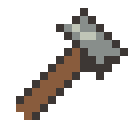 | **Martelo de Conformação** `quantumindustries:manual_hammer` | Cabeça forjada de aço com face polida. Durabilidade: 128 golpes. | Conformação mecânica manual de lingotes em chapas na Bancada de Conformação. |
| 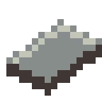 | **Chapa de Ferro Calandrada** `quantumindustries:iron_sheet` | Espessura: 3.2 mm. Alta rigidez mecânica e tenacidade estrutural. | Blindagens, carcaças de motores, serrarias e chassis industriais. |
|  | **Chapa de Cobre Laminada** `quantumindustries:copper_sheet` | Alta dissipação térmica e maleabilidade superficial. | Placas de trocadores de calor, acumuladores e contato galvânico. |
| 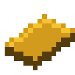 | **Chapa de Ouro Nobre** `quantumindustries:gold_sheet` | Resistência total à oxidação; filme metálico de alta pureza. | Contatos de precisão quântica e terminais de baixa impedância. |
|  | **Fio de Cobre Nu** `quantumindustries:copper_wire` | Condutividade: 98% IACS. Trefilado a partir de lingotes/chapas. | Enrolamentos de indução, barramentos e circuitos de baixa voltagem. |
|  | **Filamento de Ouro** `quantumindustries:gold_wire` | Microcondutância linear ultrabaixa e imunidade eletroquímica. | Fiação de instrumentação analítica e interconexões de alta precisão. |
|  | **Fio de Cobre Isolado** `quantumindustries:insulated_copper_wire` | Revestimento polimérico dielétrico impermeabilizado. | Elimina perdas e risco de arco voltaico ou choque em fiações expostas. |
|  | **Bobina Eletromagnética** `quantumindustries:copper_coil` | Enrolamento helicoidal compacto de alta densidade de espiras. | Indução eletromagnética em dínamos, acumuladores e relés de potência. |
|  | **Engrenagem de Ferro** `quantumindustries:iron_gear` | Módulo dentado usinado para transferência de torque sem escorregamento. | Mecanismos de serraria, dínamos, redutores e caixas de transmissão. |
| 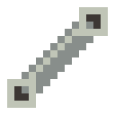 | **Eixo Retificado** `quantumindustries:mechanical_shaft` | Eixo cilíndrico torneado de ferro maciço. Suporta até 600 Nm de torque. | Interligação cinética entre manivelas, polias e dínamos. |
| 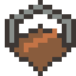 | **Chassi Estrutural** `quantumindustries:electromechanical_frame` | Gabinete modular em perfis soldados de aço-carbono. | Estrutura de sustentação para prensas pesadas e motores industriais. |
|  | **Núcleo Mecânico Primitivo** `quantumindustries:primitive_mechanical_core` | Trem diferencial de engrenagens de latão e carcaça de ferro. | Módulo de sincronização e automação mecânica da Primeira Era. |
| 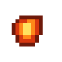 | **Lingote de Ferro Aquecido** `quantumindustries:heated_iron_ingot` | Temperatura térmica: ~980 °C (rubro intenso). | Matéria-prima maleável para forja e estampagem imediata antes de resfriar. |
| 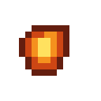 | **Lingote de Cobre Aquecido** `quantumindustries:heated_copper_ingot` | Temperatura térmica: ~850 °C (recozimento térmico). | Facilita a trefilação fina de fios sem trincas cristalinas. |

---

## 3. ⚙️ Oficina Mecânica e Transmissão Cinética

Bancadas e blocos mecânicos de rotação e corte que operam independentemente de energia elétrica (Rede de Unidades Mecânicas - UM).

| Visual | Máquina & ID | Princípio Operacional | Capacidade & Conexões |
| :---: | :--- | :--- | :--- |
| 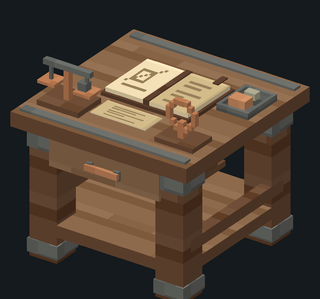 | **Mesa de Pesquisa — Tier 1** `quantumindustries:scientific_analyzer_tier_1` | Bancada artesanal em madeira, ferro e cobre com balança e caderno de campo. | Interface para o Caderno Científico, Árvore de Pesquisa e receitas desbloqueadas. |
| 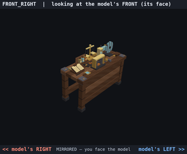 | **Analisador de Materiais** `quantumindustries:empirical_assay_bench` | Bancada com prensa de parafuso, cadinho e suporte para quatro ensaios empíricos. | Executa ensaios de 10s (inspeção, calor, químico, prensa) sobre 10 minerais (40 descobertas). |
| 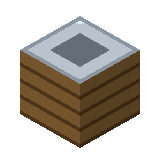 | **Bancada de Conformação** `quantumindustries:forming_bench` | Bloco reforçado com base de bigorna plana e estrado de madeira tratada. | Permite forjar chapas de metal golpeando lingotes com o Martelo Manual. |
| 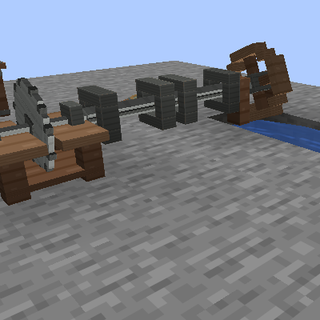 | **Serraria Mecânica** `quantumindustries:mechanical_sawmill` | Lâmina circular dentada acionada por eixo inferior ou manivela manual. | Corta 1 tora em 6 tábuas em 5 segundos (rendimento 50% superior ao corte manual). |
| 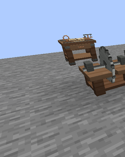 | **Roda-d’Água Primitiva** `quantumindustries:primitive_water_wheel` | Roda de pás em madeira acionada pelo fluxo tangencial de água corrente. | Gera potência cinética contínua (UM) transmitida por linhas alinhadas de eixos. |
| 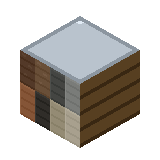 | **Eixo de Transmissão (Bloco)** `quantumindustries:mechanical_shaft_block` | Eixo rotativo encapsulado em mancais de madeira com buchas lubrificadas. | Transmite torque e potência mecânica entre máquinas sem perdas no alinhamento. |
| 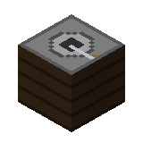 | **Moedor Manual de Grãos** `quantumindustries:manual_grain_mill` | Moinho de pedra com rotor superior de atrito e funil de alimentação para cereais. | Mó 1 trigo em 1 farinha a cada 4 giros manuais (Shift + clique para colher saída). |
|  | **Manivela de Partida Manual** `quantumindustries:hand_crank` | Braço de alavanca com empunhadura para torque muscular direto. | Instale na serraria ou no dínamo para operação mecânica inicial em sobrevivência. |

---

### 🌾 Processamento de Alimentos e Cadeia do Trigo (Era I)

Produtos do beneficiamento agrícola artesanal que otimizam o rendimento calórico do trigo em relação ao pão padrão.

| Visual | Item & ID | Processamento / Origem | Nutrição & Efeito |
| :---: | :--- | :--- | :--- |
|  | **Farinha de Trigo** `quantumindustries:flour` | Grão de trigo finamente moído entre as pedras do Moedor Manual. | Base para sova de massas; misture 2 farinhas + 1 balde d'água para produzir massa crua. |
| 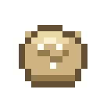 | **Massa de Pão Crua** `quantumindustries:bread_dough` | Massa hidratada e sovada pronta para fermentação e cocção em forno. | Asse em qualquer fornalha ou defumador para assar o Pão Rústico artesanal. |
|  | **Pão Rústico Artesanal** `quantumindustries:rustic_bread` | Pão colonial de crosta crocante e miolo aerado assado na lenha. | Nutrição: 5 pontos (2.5 coxas). Saturação: 0.6F (superior ao pão vanilla). |

---

---

## 4. ⚡ Geração, Armazenamento e Distribuição Elétrica

A infraestrutura da Era II para geração eletromecânica de Forge Energy (FE), acumulação galvânica e condução sem perdas.

| Visual | Equipamento & ID | Princípio Eletromecânico | Métricas Operacionais |
| :---: | :--- | :--- | :--- |
| 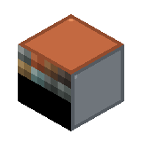 | **Dínamo Manual** `quantumindustries:manual_dynamo` | Indução rotativa por estator de ímãs e rotor de bobinas de cobre. | Armazena até 240 FE. Gera 12 FE por giro manual (intervalo mínimo: 10 ticks). |
| 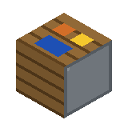 | **Acumulador Galvânico** `quantumindustries:galvanic_accumulator` | Célula eletroquímica de placas imersas em eletrólito líquido ativo. | Capacidade: 2.400 FE. Armazena e distribui carga estável para máquinas industriais. |
| 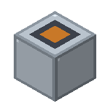 | **Prensa Eletromecânica** `quantumindustries:electromechanical_press` | Martinete de forja acionado por excêntrico acoplado a motor elétrico. | Consome 60 FE por ciclo para laminar chapas automaticamente sem gastar martelos. |
| 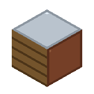 | **Trefiladora de Bancada** `quantumindustries:wire_drawing_bench` | Fieiras calibradas com tracionamento mecânico ou elétrico contínuo. | Converte 1 chapa de cobre ou ouro em 4 fios de alta uniformidade (60 FE ou manivela). |
| 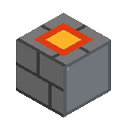 | **Forja de Recozimento Térmico** `quantumindustries:bellows_brazier` | Braseiro forçado com injeção de ar para tratamento térmico de alívio de tensões. | Aquece lingotes de ferro e cobre até o ponto rubro para processos de conformação. |
| 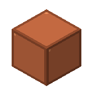 | **Barramento de Cobre Nu** `quantumindustries:copper_busbar` | Perfil maciço de cobre para transmissão elétrica de alta amperagem. | Suporta até 32 FE/t. Dissipa 1 FE por 4 blocos sem isolamento (risco de choque leve). |
|  | **Conduíte Isolado** `quantumindustries:insulated_conduit` | Cabo blindado com manta dielétrica espessa contra fuga de corrente. | Suporta até 64 FE/t sem perda por dissipação e sem choque em entidades. |
| 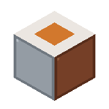 | **Transdutor Piezoelétrico** `quantumindustries:piezo_switch` | Cristal de quartzo que gera pulso de sinal ao sofrer compressão mecânica. | Atua como sensor de pressão e chave lógica ultrarrápida para automação. |
| 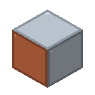 | **Relé de Carga** `quantumindustries:load_relay` | Interruptor magnético acionado por limiar de corrente ou nível de buffer. | Proteção de sobrecarga e chaveamento automático de circuitos secundários. |

---

## 5. 🧪 Hidráulica, Pneumática e Reagentes

Redes de transporte tubular para itens via pressão de ar e dutos para fluidos eletrolíticos e sedimentos químicos.

| Visual | Dispositivo / Item & ID | Função Operacional | Parâmetros de Processo |
| :---: | :--- | :--- | :--- |
| 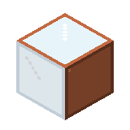 | **Tubo Pneumático de Vidro** `quantumindustries:pneumatic_tube` | Duto com vácuo parcial e anéis de cobre para transporte rápido de pacotes. | Guia cápsulas de itens através de gradientes de pressão sem engasgos. |
| 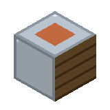 | **Ejetor com Fole** `quantumindustries:bellows_ejector` | Pulmão mecânico que injeta pulsos de ar para disparar itens nos tubos. | Consome 10 FE por pulso de ejeção quando abastecido com pacotes válidos. |
| 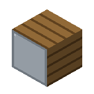 | **Classificador Gravitacional** `quantumindustries:gravitational_sorter` | Câmara com fluxo ascendente de ar e grelhas gravimétricas ajustáveis. | Separa itens pesados para o duto inferior e leves para a saída lateral. |
|  | **Duto Hidráulico de Cobre** `quantumindustries:fluid_pipe` | Tubulação metálica opaca com juntas de vedação estanques para líquidos. | Transfere fluidos químicos e soluções iônicas sob pressão controlada. |
|  | **Duto Hidráulico de Vidro** `quantumindustries:glass_pipe` | Tubulação transparente de borossilicato para inspeção visual de fluxo. | Permite observar nível, coloração e escoamento de reagentes em trânsito. |
| 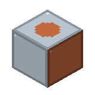 | **Bomba Peristáltica** `quantumindustries:peristaltic_pump` | Rotores que comprimem o tubo flexível para bombeamento sem contato. | Garante vazão em mB/t com buffer interno de FE para vencer desníveis verticais. |
| 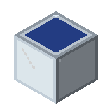 | **Cuba de Decantação** `quantumindustries:settling_vat` | Tanque envidraçado para precipitação e separação por densidade. | Separa suspensões minerais em água, decantando pigmentos e eletrólitos. |
|  | **Eletrólito Galvânico** `quantumindustries:galvanic_electrolyte` | Solução rica em íons livres formulada em frasco de laboratório. | Carga química ativa necessária para operação e regeneração do Acumulador Galvânico. |
| 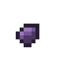 | **Sedimento Mineral** `quantumindustries:pigment_sediment` | Precipitado particulado seco recolhido no fundo da cuba de decantação. | Reagente precursor de purificação para sínteses químicas e reagentes avançados. |

---

## 6. 📜 Documentação e Base de Conhecimento

O conhecimento é o pilar de progressão do Quantum Industries. Estes itens registram, transferem e desbloqueiam tecnologias entre jogadores e servidores.

| Visual | Registro & ID | Significado Científico | Comportamento no Jogo |
| :---: | :--- | :--- | :--- |
|  | **Relatório de Pesquisa** `quantumindustries:research_data` | Dossiê formal com blueprint técnico, formulações e diagramas de processo. | Consumível ao clicar: se o jogador cumprir os pré-requisitos, aprende a pesquisa. |
|  | **Ficha de Observação** `quantumindustries:empirical_field_notes` | Caderno de campo encadernado em couro com os 4 ensaios completos de um mineral. | Compartilhável entre operadores: ensina as quatro descobertas daquele material a outro jogador. |
|  | **Analisador Científico — Tier 2** `quantumindustries:scientific_analyzer` | Estação eletrônica avançada com rede de difração, osciloscópio e tela de dados. | Permite formular hipóteses das Eras II e III e pesquisar tecnologias eletromagnéticas. |

---

> **Diretrizes de Manutenção:** Todas as imagens neste catálogo são mantidas com pixel art original do mod em alta nitidez sob `docs/images/items/` e `docs/images/blocks/`. Novos itens devem ser registrados através do script `scripts/export_showcase_assets.py`.
