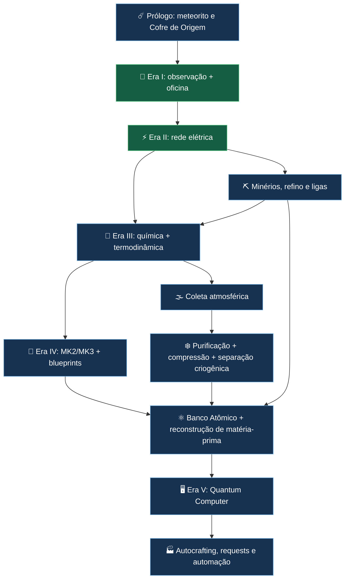
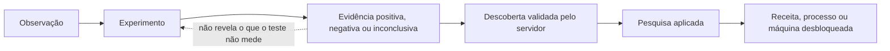
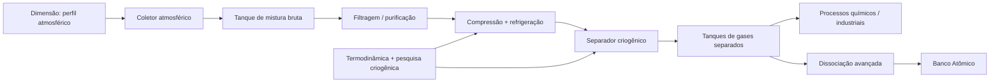

# ☄️ Quantum Industries — Roadmap Mestre até o Quantum Computer

> **Documento de planejamento, não declaração de implementação.** Preserva as **cinco eras oficiais** do mod e organiza química, termodinâmica, ciência dos materiais e atmosfera como **linhas transversais**. GDD: [GDD_QUANTUM_INDUSTRIES.md](GDD_QUANTUM_INDUSTRIES.md). Discussão principal: [issue #25](https://github.com/Vizinho-hn/Quantum-Industries/issues/25).

**Objetivo da experiência:** começar por uma descoberta misteriosa, aprender a fazer ciência por experimentos e terminar com uma rede industrial que reconstrói **matérias-primas** a partir de estoques elementares e fabrica **itens complexos pelas máquinas**, atendendo pedidos no estilo AE2.

## Legenda de acompanhamento

- `[x]` = já documentado como existente no protótipo (ainda sujeito a teste de regressão).
- `[ ]` = planejamento / implementação ou validação pendente.
- Cada caixa do GitHub é **clicável** ao editar este Markdown (ou por permissões adequadas no fluxo de issues). O diagrama Mermaid é navegável pela estrutura do documento; os checkboxes abaixo são a fonte de verdade do progresso. Não presumir que Mermaid por si armazena estado.
- [Abrir painel interativo local](../docs/ROADMAP_INTERATIVO.html) (se hospedado como site estático; links a HTML em `github.com` não executam scripts). O HTML pode ser aberto localmente para checkboxes persistentes no navegador.

## Fluxo principal

### Fluxo de conhecimento

## 0. Prólogo e onboarding — **Meteoro / Cofre de Origem**

O evento abre o mundo sem entregar magicamente todas as respostas.

- [ ] Definir a cena de chegada: **um meteorito cruza o céu e atinge um local seguro próximo ao spawn**, uma vez por mundo; a sequência é cosmética, sem explosão destrutiva real.
- [ ] Criar estrutura **Cratera de Origem** e **Cofre de Origem** (*vault* próprio, não dependente da mecânica vanilla de Trial Chambers).
- [ ] Cofre contém o **Manual de Campo Quantum Industries**, com lore breve, índice e primeira missão.
- [ ] Permitir **recompensa individual por jogador** ao interagir com o cofre compartilhado; nunca restringir o início ao primeiro jogador do servidor.
- [ ] Livro/tutorial guia: localizar cratera → abrir cofre → inspecionar material → Mesa de Pesquisa Tier 1 → Observação dos Materiais → Analisador Empírico → experimentos → oficina → dínamo.
- [ ] Salvar `meteor_event_generated`, posição da cratera e `player_onboarding_progress` no servidor; evento idempotente em reload e com acesso seguro ao manual.
- [ ] Proteção: não destruir construções, evitar áreas protegidas/estruturas perigosas, sem incêndio real, proteção contra duplicação e coordenadas recuperáveis.
- [ ] Mundo antigo: habilitação explícita ou estrutura alternativa, sem impacto automático em bases construídas; comando de recuperação e alternativa para livro perdido.
- [ ] Acessibilidade: efeitos visuais/sonoros opcionais, waypoint configurável, possibilidade de iniciar tutorial sem animação.
- [ ] Testar solo, servidor, duas entradas simultâneas, save/reload e mundo legado.

**Vertical slice do prólogo:** cratera pré-gerada com cofre funcional e livro de 5 etapas; cinematic e meteorito voando ficam para o polimento.

## 1. Era I — Engenharia Mecânica e Ciência Empírica

**Já descrito no repositório:**
- [x] Mesa de Pesquisa Tier 1 e pesquisa `Observação dos Materiais` como porta de entrada.
- [x] Bancada de Ensaio Empírico `empirical_assay_bench` com 10 materiais × 4 métodos (inspeção, aquecimento, reação, prensa), **40 descobertas por jogador**.
- [x] Oficina mecânica com serraria, transmissão, roda-d'água e Dínamo Manual, segundo o README atual.

**Antes de declarar pronto:**
- [ ] Rodar regressão dos 40 resultados, migração de saves e acesso multiplayer.
- [ ] Integrar o Manual de Campo à árvore e às receitas realmente desbloqueadas.
- [ ] Ajustar descrições: “reação em frasco” é o método atual; **HCl diluído** será um reagente específico planejado, não assumir que já exista no jogo.
- [ ] Garantir que falha de reação produza observação válida, mas **não** identificação falsa do mineral.
- [ ] Fazer playtest da Era I do livro inicial ao primeiro dínamo.

## 2. Era II — Revolução Elétrica

- [x] Acumulador galvânico, prensa eletromecânica e início da distribuição elétrica documentados no README.
- [ ] Confirmar em gameplay geração, consumo, gargalos, redes e compatibilidade de saves.
- [ ] Introduzir ferramentas de medição para experimentos de condutividade, magnetismo e eletricidade.
- [ ] Preparar infraestrutura de alimentação para química, aquecimento e máquinas instrumentais.
- [ ] Definir padronização de consumo por operação para futuras fábricas e balanceamento.

## 3. Linha transversal — recursos, química e metalurgia

- [ ] Auditar receitas: dependências sem fonte de obtenção e itens sem propósito.
- [ ] Priorizar **cassiterita → estanho**, **esfalerita → zinco**, fontes de enxofre e outros minerais conforme necessidade; manter cobre/quartzo vanilla.
- [ ] Implementar cobre + estanho → **bronze** e cobre + zinco → **latão**, com proporções adequadas ao sistema de unidades do jogo.
- [ ] Definir britagem/refino/fundição como processos em etapas, ao invés de forçar tudo em forno vanilla.
- [ ] Criar líquidos/reagentes relevantes, incluindo HCl diluído para teste de carbonatos.
- [ ] Separar conceitos: fluido **de cor âmbar** não exige existência de item **âmbar**; este só entra se tiver receita e origem.
- [ ] Exibir entradas/saídas de cada processo no manual; assegurar loop de survival completo.
- [ ] Testar economia: produção, subprodutos, energia e ciclos de conversão sem duplicação.

## 4. Era III — Ondas Eletromagnéticas e Tecnologia Moderna

**Linhas cruzadas:** eletrônica/controle; instrumentação; química; termodinâmica e gases.

- [ ] Calor, equilíbrio térmico, medições e condução.
- [ ] Primeira lei da termodinâmica, energia interna, trabalho e transferência térmica.
- [ ] Pressão, volume, temperatura e comportamento de gases.
- [ ] Máquinas térmicas: compressores, trocadores, sistemas de rejeição de calor.
- [ ] Refrigeração industrial: expansão, ciclos e resfriamento.
- [ ] **Engenharia criogênica**: liquefação e destilação, pesquisa desbloqueada por **experimentos e evidências**; evitar desbloqueio automático por XP.
- [ ] Aproveitar as mesmas pesquisas em motores, caldeiras, turbinas, reatores e refrigeração futura.

### 🌫️ Coletor Atmosférico e separação

- [ ] Coletor extrai **mistura**, nunca átomos diretamente.
- [ ] Perfis atmosféricos orientados a dados por dimensão (Overworld, Nether, End e dimensões modded).
- [ ] Overworld inspirado na Terra (N₂, O₂, Ar, traços de CO₂); Nether/End são **ficção declarada pelo mod**.
- [ ] Tentar coletar em dimensão sem atmosfera deve exibir impedimento, não gerar gás padrão.
- [ ] Balancear **custo total maior** de operação em dimensões avançadas, com máquinas, filtros, riscos e infraestrutura; não é lei física universal.
- [ ] Separador criogênico somente após a pesquisa térmica; **centrífuga comum não separa N₂/O₂ como processo industrial básico**.
- [ ] Reservatórios, pureza, vazão, FE/t, recuperação pós-restart e testes anti-dupe.
- [ ] Dissociação molecular **posterior**: N₂ ou O₂ não são estoques de átomos livres.

## 5. Era IV — Engenharia Quântica e Ciência Avançada dos Materiais

- [ ] **Material Analyser MK2**: métodos como espectroscopia Raman/óptica, magnetismo, propriedades físicas; conhecimento depende do método.
- [ ] Caso didático **quartzo**: ausência de efervescência com HCl no MK1 = inconclusivo; assinatura instrumental no MK2 permite identificação adequada.
- [ ] **Material Analyser MK3**: composição elementar, proporções, estrutura molecular ou cristalina, quando mensurável.
- [ ] **Blueprint material** distinto de receita de item; dois materiais podem ter mesma composição e estruturas diferentes (grafite/diamante).
- [ ] Descobertas persistidas por jogador; não alterar IDs de descobertas anteriores nem misturar com a nomenclatura das Mesas de Pesquisa Tier 1/Tier 2.
- [ ] Modelar limites de detecção, pureza da amostra e dados insuficientes, sem entregar conhecimento automaticamente.

## 6. Matéria programável — ponte Era IV → V

- [ ] `MaterialRegistry` / `MaterialBlueprintRegistry` orientados a dados.
- [ ] **Decomposer** converte materiais permitidos em estoques de elementos equivalentes; condições e rendimento.
- [ ] **Banco Atômico** registra C, O, Si, Fe, Cu, Sn etc. separadamente, com unidades normalizadas por massa/mol, **não átomos livres armazenados literalmente**.
- [ ] **Matter Assembler** reconstrói **matérias-primas** pesquisadas; consome estoque e energia, com rendimento/tempo.
- [ ] Evitar EMC universal, matérias-primas sem limites e receitas que produzem recursos infinitos.
- [ ] Reserva/debito atômico de estoque, dados de rede sob autoridade do servidor, testes anti-duplicação e multiplayer.
- [ ] Exemplo integrado: cobre + estanho → processamento de bronze → engrenagens por máquinas; nada de engrenagem criada diretamente pelo banco.

## 7. Era V — Inteligência Artificial e Automação Autônoma

- [ ] `QuantumComputer`: interface com estoques **físico**, **atômico** e **biblioteca de conhecimento**.
- [ ] Pedidos (*requests*) para itens/quantidades, planejador de dependências e escolha de rotas.
- [ ] Fila persistente; reserva de componentes/energia, retomada após unload/restart, sem receitas cíclicas.
- [ ] Autocrafting de itens complexos **executado pelas máquinas**, estilo AE2; o Banco Atômico só supre matérias-primas.
- [ ] Reposição automática e conexão com os coletores, tanques, oficinas, fundições e montadores.
- [ ] Análise instrumental integrada de alto nível, respeitando capacidades científicas desbloqueadas.
- [ ] Balanceamento: produção rápida de matéria-prima somente com infraestrutura e energia endgame.
- [ ] **Nota científica:** controle industrial poderia ser feito por computadores clássicos; “quântico” é identidade futurista do mod, não promessa de vantagem quântica real.

## Marcos de entrega e dependências

| Marco | Valor demonstrável | Depende de |
|---|---|---|
| M0 — Prólogo vertical | Cratera + cofre + livro com primeiro tutorial | persistência, bloco, loot individual |
| M1 — Era I íntegra | Primeiro experimento → dínamo, sem quebra de saves | base atual, testes |
| M2 — Recursos reais | Estanho, zinco, bronze e latão obtíveis | geradores, receitas, máquinas |
| M3 — Termodinâmica | Experimento térmico → compressor → refrigeração | M1, energia |
| M4 — Atmosfera | Gás bruto → gás separado no Overworld | M3 |
| M5 — MK2/MK3 | Quartzo inconclusivo → identificado → blueprint | pesquisa, instrumentação |
| M6 — Banco Atômico | Decompor e reconstruir uma matéria-prima | M2, M5 |
| M7 — Rede piloto | Pedido de engrenagem usa estoque + fundição | M6, automação |
| M8 — Quantum Computer | Request multiestágio, retomável, sem duplicação | M4, M7 |

## Critérios gerais de aceite

- [ ] Nenhum desbloqueio científico revela propriedades que não foram observadas/medidas.
- [ ] Sem matéria universal ou criação de itens complexos pelo Banco Atômico.
- [ ] Energia, massa, vazão, composição dimensional e pureza balanceadas com consistência.
- [ ] Tutorial recuperável em multiplayer, sem destruição involuntária de saves/estruturas.
- [ ] Conhecimento é **individual**, máquinas e rede são **compartilháveis conforme permissões**.
- [ ] Regressão dos 40 ensaios da Era I, pesquisas antigas e IDs de bloco/item.
- [ ] Testes automatizados para reload, jobs, sincronização, quebra de blocos e tentativas de duplicação.

## Referências internas

- [README](../README.md) · [Arquitetura](ARCHITECTURE.md) · [Sistema de pesquisa](RESEARCH_SYSTEM.md)
- [Ensaios existentes](design/bancada-de-ensaio/README.md) · [Integração científica](SCIENTIFIC_RESEARCH.md)
- [Discussão de progressão e banco de matéria: #25](https://github.com/Vizinho-hn/Quantum-Industries/issues/25)
