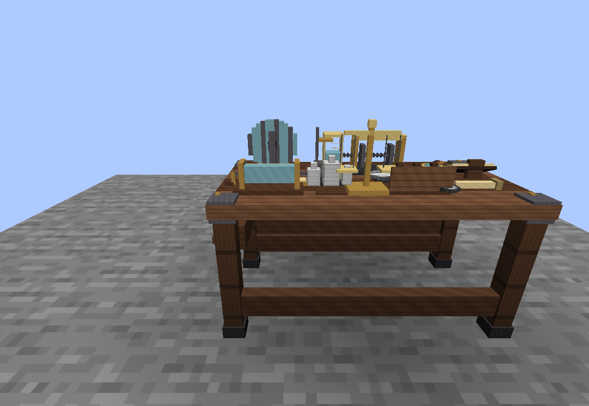
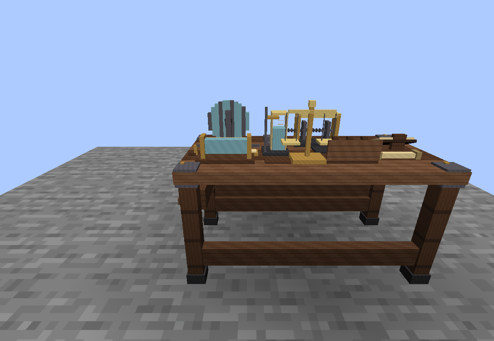
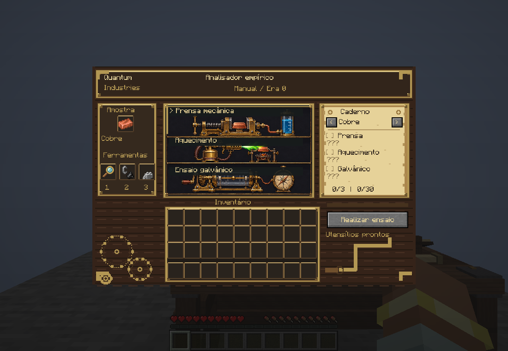
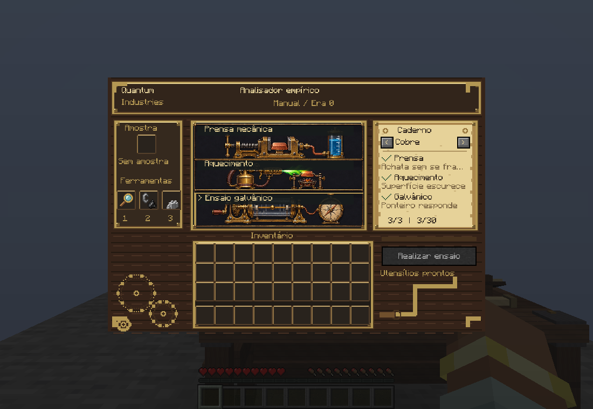

# Bancada de ensaio — primeira versão funcional

A bancada registra observações individuais de dez materiais por três métodos:
prensa mecânica (maleabilidade), aquecimento (comportamento ao fogo) e ensaio
galvânico (condução elétrica qualitativa). As respostas descrevem as condições
limitadas deste ensaio; ausência de resposta não comprova uma propriedade universal.

## Como usar

1. Coloque uma amostra aceita e a lupa nos respectivos slots.
2. Selecione um dos três painéis. A prensa exige também pesos de ferro;
   o aquecimento exige também o isqueiro vanilla. A manivela e a bússola já pertencem à mesa.
3. Clique em **Realizar ensaio** e aguarde 3 segundos (60 ticks do servidor).
4. Consulte a observação no caderno. Selecione os demais métodos para completar o material.

O caderno permite percorrer os dez materiais e consultar apenas os resultados já
conhecidos. Mostra até 3 descobertas por material e 30 no catálogo geral. Consultas
não exigem amostra, não consomem itens e não concedem recompensas.

## Amostra e persistência

O primeiro ensaio válido retira exatamente uma unidade do slot e a reserva no
perfil individual. A indicação de reserva na HUD não é um segundo item retirável.
Existe apenas um ciclo aberto por jogador. Fechar a tela, sair do mundo ou usar
outra bancada permite retomar a mesma amostra e os resultados anteriores.

Interromper o teste cancela somente o temporizador. Acesso e ferramentas são
revalidados pelo servidor; um teste interrompido precisa ser iniciado novamente.
A reserva é consumida definitivamente ao completar os três métodos únicos.
Ferramentas são reutilizáveis. Os quatro slots pertencem à bancada: fechar a
HUD não devolve ferramentas nem amostras ainda não reservadas ao inventário.
Os itens permanecem após salvar e carregar o mundo, podem ser retirados pela
interface e caem ao quebrar a bancada. Os dois lados do bloco acessam o mesmo
inventário; jogadores que usam a mesma bancada compartilham esses itens.

A lupa, o isqueiro, os pesos e a amostra aparecem sobre a bancada somente quando
ocupam seus slots. Ferro aparece como lingote de ferro, ouro como lingote de ouro,
e assim por diante. A lupa decorativa e as amostras fixas foram retiradas do modelo.
Quando o primeiro ensaio reserva uma amostra, ela deixa o slot físico e passa a
ser indicada como **Reservada** na HUD. Essa reserva continua individual e não
é um segundo item exposto ou retirável da bancada. Dois jogadores mantêm ciclos e descobertas independentes.

As descobertas usam identificadores estáveis de material e método, separados das
pesquisas existentes. O contador antigo do cobre migra, na ordem, para prensa,
aquecimento e ensaio galvânico; não revela resultados de outros materiais.

## Catálogo de observações

| Amostra aceita | Prensa mecânica | Aquecimento | Ensaio galvânico |
| --- | --- | --- | --- |
| Lingote de cobre | Achata sem se fragmentar (Maleável) | Superfície escurece | Ponteiro responde |
| Lingote de ferro | Oferece maior resistência à deformação | Superfície escurece | Ponteiro responde |
| Lingote de ouro | Deforma facilmente | Sem alteração visível neste ensaio | Ponteiro responde |
| Carvão | Fragmenta e produz pó | Queima e deixa resíduos | Sem resposta conclusiva |
| Diamante | Não apresenta deformação visível | Sem alteração visível neste ensaio | Sem resposta detectável |
| Quartzo | Fratura sem formar uma chapa | Sem alteração visível neste ensaio | Sem resposta detectável |
| Pó de redstone | Pó se compacta, sem formar chapa | Escurece, sem chama característica | Resposta pulsante (comportamento ficcional do mod) |
| Lápis-lazúli | Fragmenta, produzindo pó azul | Sem alteração diagnóstica | Sem resposta detectável |
| Esmeralda | Fratura, sem deformação plástica | Sem alteração diagnóstica | Sem resposta detectável |
| Fragmento de ametista | Fragmenta sob pressão | Sem alteração diagnóstica | Sem resposta detectável |

Blocos, minérios brutos e carvão vegetal não são aceitos. A bancada não informa
fórmula química, estrutura atômica, dureza medida, resistividade ou valores de
condutividade. Aquecer o lingote de cobre não revela uma chama verde fixa.

## Ferramentas e progressão inicial

- **Lupa:** item próprio, feito com vidro, graveto e pepita de ferro.
- **Isqueiro:** o item vanilla inicia o aquecimento no aparato da bancada; não
  existe uma segunda ferramenta obrigatória chamada kit de chama. Nesta versão,
  seu uso na bancada não gasta durabilidade.
- **Pesos de ferro:** item próprio, feito com lingote e pepita de ferro. Não exige
  produzir latão nem introduz uma liga antes da etapa de metalurgia.

Para compatibilidade com mundos existentes, o identificador dos pesos continua
`quantumindustries:brass_weights`. O antigo `flame_test_kit` ainda é reconhecido
em saves, mas não aparece na aba criativa e sua receita foi retirada.

## Galeria

Capturas reais do cliente de desenvolvimento, em 2026-11-04.

### Bancada com itens guardados



Trocar a amostra muda o item exibido no mundo:


### Bancada sem itens



### Interface de ensaio





## Próxima etapa de design

Definir com o Hian as aplicações tecnológicas destas observações e a integração
com pesquisas e receitas. Esta entrega mantém a árvore de pesquisas, os relatórios
existentes e os bloqueios de receitas.

## Verificação reproduzível

Com Java 25 e o cache Gradle disponível, execute na raiz:

```bash
python3 -m unittest discover -s tests -v
./tools/verify-assay.sh
./gradlew build
```

O segundo comando inclui temporariamente as fontes de `tests/runtime`, inicia
um servidor dedicado em `build/assay-verification/world` e exige um resultado
explícito `PASS` em `build/assay-verification/result.txt`. Exercita os dez materiais,
os três métodos, início inválido e duplicado, interrupção, reserva e consumo,
retomada em outra bancada, persistência NBT, clone após morte, independência entre
jogadores e migração do contador antigo. O mundo de verificação aceita a EULA
localmente e usa a porta 25576. As classes do ensaio automatizado não entram no
JAR de um build normal.

`tests/assay-preview.init.gradle` habilita um cliente de verificação separado em
`build/assay-preview`, com capturas da HUD e dos itens no mundo. As fontes de preview também são
excluídas de builds normais.

Para executar o preview com carga reduzida, use `./tools/preview-assay.sh`
(requer Xvfb, Java 25 e o cache Gradle já preenchido). O script usa janela de
1100×760, 30 FPS, 2 chunks de renderização, distância de simulação 5 e dois
threads de renderização por software. Limita a execução a quatro minutos e
exige oito capturas novas em `build/assay-preview/screenshots`. A abertura
da interface ocorre depois do teleporte, para permitir sua sincronização.

Validação visual concluída em 2026-11-04: estado inicial 0/3, ensaio em curso,
primeira descoberta, aquecimento e ciclo completo 3/3, com consumo da amostra
reservada e encerramento normal do cliente. As observações longas são abreviadas
no caderno; o texto completo está disponível ao passar o mouse. O teste usou
llvmpipe com os limites acima; a causa do travamento anterior segue sem confirmação.


## Validação do armazenamento

Em 2026-11-04 passaram **521 verificações de integração no servidor**, incluindo
retenção ao fechar a HUD, serialização e carregamento do inventário, dois
jogadores acessando os mesmos slots, retirada sem duplicação e queda dos quatro
itens armazenados ao quebrar o bloco. Os **11 testes de contratos e recursos**
também passaram. O preview captura a HUD e a bancada com ferro, ouro e slots vazios.
